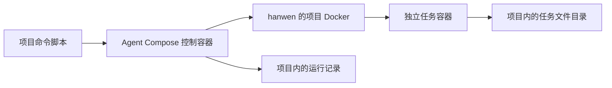

# 第 5 步 B：让 Agent Compose 管理一个真实任务环境

日期：2026-10-18（服务器北京时间；控制容器使用 UTC）。承接 [Docker 运行环境](06-Docker运行环境.md)。本轮已完成控制服务和命令工作区的真实验收。

## 这次到底增加什么

上一步证明了 hanwen 可以在项目内运行 Docker。可是网页后端仍然直接创建 Pi SDK 会话，没有人专门管理任务容器。

这一小步先安装“管理任务环境的人”：Agent Compose。先让它开一个工作环境，执行我们事先写好的命令，再查运行结果。命令由我们确定，模型没有参与，因此不消耗 MiniMax 调用额度。这与原仓库先准备 workspace、再向其中发送正式任务的职责顺序一致。

可以先把三个东西分开理解：

| 名称 | 做什么 | 本步中的例子 |
| --- | --- | --- |
| Docker | 真正创建和运行容器 | 创建控制容器和任务容器，挂载文件目录 |
| Agent Compose | 决定按什么配置创建任务环境，并保存项目、运行、环境的记录 | 接受 up/run/inspect/stop 命令 |
| Pi | 在任务环境中连接模型、执行 Agent 循环 | 本步尚未启动；后续验证个人仓库的 Pi 1.2.0 |

注意两个容器是并列的：控制容器通过 Docker socket 请求宿主上的项目 Docker 创建任务容器。不是在控制容器里面再运行一个 Docker。



## 与原仓库怎样对应

参考仓库基准为 `67d275494c50f1e5c205b96b72a7b1623acfbe1d`，底层 Agent Compose 固定为官方 `v2609.3.0`。

- 原仓库 `compose.yml` 的 `agent-compose` 服务：启动管理程序并连接 Docker。我们保留这个职责，但用上一轮的项目 rootless socket，挂载范围缩小到必要文件。
- 原仓库 `agent-compose.yml` 的 `designer`：定义 provider、model、guest image 和 Docker driver。我们保留这个名称和配置层次，专业工具与提示词后续逐步引入。
- 原仓库 `packages/agent-runtime/executor.ts`：先执行 `up`，再 `run --detach --keep-running designer --command ...` 准备 workspace，通过 `inspect run` 查状态。我们本步先在命令行验证这条链路；之后才把它接进自己的运行时适配器。

Docker Compose 和 Agent Compose 是两个程序。两个配置文件的名字只差一个前缀，但读取它们的程序不同。

这里的 Docker Compose 项目叫 `sirna-pi`，负责管理服务及其网络；Agent Compose 中登记的项目叫 `sirna-pi-learning`，其中的 Agent 叫 `designer`。它们处于不同层次，不是重复创建了两个 Git 仓库。

## 按文件看这次增加的内容

### 1. compose.yml：启动管理服务

`services.agent-compose.image` 固定官方版本与 SHA-256 摘要。版本是便于人阅读的名称，摘要用于精确指定镜像内容。控制镜像和 guest 镜像是两个不同镜像，不能混用。

`environment` 设置控制服务的数据根目录 `/data`、HTTP 监听端口 7410，以及 Docker socket。`AGENT_COMPOSE_SOCKET` 是管理程序自己的本地通信入口；它和 Docker socket 也不是同一个东西。

`volumes` 只有三项：

| 服务器上的文件或目录（均相对本项目） | 管理容器里的路径 | 用途 |
| --- | --- | --- |
| `runtime/docker/run/docker.sock` | `/var/run/docker.sock` | 请求项目 Docker 创建和管理容器 |
| `runtime/agent-compose/data` | `/data` | 保存数据库、任务环境和运行文件 |
| `agent-compose.yml` | `/project/agent-compose.yml`，只读 | 读取 designer 的配置 |

原仓库还把整个仓库挂到 `/project`。本学习环境中 `docs/auth.json` 就放在仓库目录内，所以本步只挂需要的单个配置文件。

`ports` 的 `127.0.0.1:7410:7410` 表示服务器本机可访问控制服务，未向公网开放。容器内部使用 Compose 的专用 bridge 网络，任务容器由上游自动加入同一网络。

`restart: unless-stopped` 是项目 Docker 已运行时的容器重启策略。它不等于服务器开机时自动启动项目 Docker；上一轮尚未配置的开机自启仍未实现。

### 2. agent-compose.yml：描述 designer 的任务环境

`provider: pi` 选择 Agent 类型；`model: minimax-cn/MiniMax-M3` 保留我们真实选定的模型。它们只是一份配置，并不表示现在已经调用了模型。

`driver.docker` 表示由 Docker 提供环境；`image` 指定环境内预先安装的软件；`sandbox.stopped_runtime_policy: remove` 表示停止时移除运行容器。持久的工作文件由单独的宿主目录保存，后面会分别检查容器状态与文件状态。

**本步的明确限制：** 官方 guest 内置 Pi 0.82.1；参考仓库另做了 Pi 0.85.1 的定制 guest；我们的现有 SDK 使用 Pi 1.2.0。本步运行固定 shell 命令，不启动上述任意版本的 Pi，所以不能据此声称 Pi 1.2.0 的容器接入已完成。

### 3. scripts/prepare-agent-compose.mjs：准备私有运行状态

这个脚本只允许以 Linux 的 hanwen 身份运行，只向固定项目路径写入。它创建 `runtime/agent-compose` 和 `data`，检查真实路径、属主及 0700 权限，防止运行目录被链接到项目之外。0700 表示只有文件夹的拥有者能够访问它。

随后生成一个随机的管理令牌，保存到 `runtime/agent-compose/control.env`，权限 0600，即只有拥有者可以读写。写文件的 `wx` 模式表示“只创建新文件，已有文件就拒绝覆盖”。重复运行会检查并保留已有令牌，不悄悄更换。程序不读取 `docs/auth.json`，也不会显示令牌内容。

`compose.yml` 中的 `env_file` 把该令牌作为环境变量交给控制容器，不把令牌文件挂进 guest。验证 Docker Compose 配置时使用 `config --quiet`；不要输出完整解析配置，因为它可能展开令牌内容。后面的 `project-agent-compose.sh config` 属于另一个程序，只检查任务配置。

这个令牌控制“谁可以要求管理服务创建或操作环境”。MiniMax key 控制“谁可以调用模型”，两者用途不同。`control.env` 位于 `data` 的旁边，不会随着任务数据目录挂进 guest；它也被 `runtime/` 的 Git 忽略规则排除。

### 4. scripts/start-project-agent-compose.sh：启动入口

先用服务器已有的 Node 24 执行准备脚本，再调用上一轮的 `project-docker.sh` 执行 Docker Compose。指定项目名 `sirna-pi` 和配置文件，等待服务健康。

所有 Docker 操作继续经项目包装脚本，明确连接 `runtime/docker/run/docker.sock`。不切换系统 Docker context，不使用 sudo，不访问共享 Docker。

### 5. scripts/project-agent-compose.sh：操作入口

这个脚本先进入管理容器，复用官方镜像自带的 `/app/agent-compose`。不再向服务器安装第二份 Agent Compose 可执行文件。

容器内 CLI 通过管理服务的 Unix socket 连接。上游允许同一身份的本地进程通过它管理服务；该 socket 没有挂给 guest。外部 HTTP 管理请求仍必须持有前述令牌。

这里专门核查过一个易错点：v2609.3.0 的 CLI 不会自动把 `AGENT_COMPOSE_AUTH_TOKEN` 环境变量变成 HTTP 登录信息。我们因此使用其官方支持的本地 socket 连接方式。

### 6. scripts/verify-agent-compose-workspace.mjs：用实际运行验收

脚本首先检查管理接口拒绝未登录请求、guest 镜像已存在，再执行 `up` 和固定命令。命令创建四个工作目录并写入一个随机标记；这里的随机只是为了分辨本次结果，不是让模型自由生成内容。

随后持续查询本次 run，要求状态为 `succeeded`、退出码为 0；读取返回的工作目录，并直接从服务器验证标记。它还查询 Docker 的真实挂载和网络，检查 guest 没有获得管理令牌、模型 key、Docker socket 或整个仓库挂载；在 guest 内访问管理 HTTP 也必须返回 401。

最后只停止本次创建且已核对的 sandbox，要求 `vm_status=stopped`、`stopped_runtime_state=released`、运行容器已不存在，但标记文件仍可读取。检查中途失败会保留编号和现场，供定位原因。证据写入本项目 `runtime/agent-compose/verify-<随机后缀>/`，不进入 Git。

## 一次命令运行怎样经过这些文件

在服务器项目目录中：

```sh
sh scripts/start-project-agent-compose.sh
sh scripts/project-agent-compose.sh status
sh scripts/project-agent-compose.sh config
sh scripts/project-agent-compose.sh up
```

`up` 是把 designer 配置登记为一个 Agent Compose 项目；它不是网页里的“新建任务”，也不是启动 Pi 模型请求。

随后用 `run --detach --keep-running designer --command ...` 创建一次命令运行。`--detach` 表示先返回运行编号；`--keep-running` 表示命令结束后保留环境，方便查询和继续使用。再用 `inspect run <runId>` 查看是否 succeeded、退出码是否为 0，并取得 `sandbox_id`。`runId` 是某次执行的编号，`sandbox_id` 是执行环境的编号。

Agent Compose 将数据中的任务目录映射给 guest 的 `/workspace`。本版本按日期组织新环境：guest 看到 `/workspace/...`，服务器看到本项目 `runtime/agent-compose/data/sandboxes/<年>/<月>/<日>/<sandboxId>/workspace/...`。实际路径从 `inspect sandbox` 返回的 `workspace_path` 读取，不根据自己电脑的日期猜测。这称为挂载，不是先在容器写好后再复制回服务器。

最后通过 `sandbox stop --graceful <sandboxId>` 停止本次测试环境，并再次检查文件是否保留。本步不执行全局 prune，也不删除历史任务数据。

## 为什么本步暂时留空模型回调地址

上游在执行固定命令之前，也会准备 provider 的环境。源码 `EnsurePiFacadeConfig` 先检查模型名的格式，再判断是否配置了可访问的模型代理地址；地址为空时直接返回，不查询模型凭据。

因此当前 `AGENT_COMPOSE_RUNTIME_BASE_URL` 显式留空，HTTP 服务仍正常监听。这是本阶段只验命令工作区的设置。后续接模型时，需要改成 guest 能访问的 `http://agent-compose:7410`，配好受控模型代理，并实际验证 Pi 1.2.0，不能只改一个字符串就宣称接通。

## 实际验收

服务器执行：

```sh
cd /home/hanwen/Project/project/siNRA-pi
/home/hanwen/.nvm/versions/node/v24.16.0/bin/node scripts/verify-agent-compose-workspace.mjs
```

脚本退出码 0，结果为 `passed: true`。实际观察：

| 检查 | 本轮结果 |
| --- | --- |
| 控制服务 | healthy，官方 v2609.3.0，linux/amd64 |
| 管理端口 | 宿主仅监听 127.0.0.1:7410 |
| 未登录请求 | 从宿主和 guest 访问管理 API 均返回 401 |
| 命令执行 | run 从 pending 到 succeeded，exit_code=0；执行输出包含 /workspace 和本次标记 |
| 真实文件 | 容器写入的 workspace-check.txt 可直接在服务器项目目录读取，内容一致 |
| 挂载和网络 | guest 的 18 项默认挂载均属于本次 sandbox；无 Docker socket、整仓或密钥文件；与控制服务同在 sirna-pi_default 网络 |
| 停止之后 | vm_status=stopped，stopped_runtime_state=released，Docker 中测试容器已移除；标记文件仍存在 |
| 资源限制 | 实际 inspect 为 Memory=0、PidsLimit=null；未设置 guest 资源配额 |
| 原网页 | 健康接口仍为 local-pi、taskContainers=false |
| 回归检查 | 原有 49 项离线测试通过，未调用模型 |

本轮证据目录（服务器）：

```text
/home/hanwen/Project/project/siNRA-pi/runtime/agent-compose/verify-RaHJj9/
```

其中 `project.json` 是登记结果；`started.json` 和 `run.json` 是本次运行；`sandbox-running.json`、`sandbox-stopped.json` 是前后环境状态；`mounts-and-network.json` 保存经过筛选的挂载与网络信息；`result.json` 是最终验收结论。这些均为本步固定命令的运行产物，不进入 Git。

本次 runId 为 `9dc0b1019345e6e9b74fefa78bc52a23cb4c88541cc981eeed3c50953c0bf33a`，sandboxId 为 `a737df74d8ba345e490ecd07c6f8b9eaa974bbdff532677633cc1207dc113c94`。真实产物路径：

```text
/home/hanwen/Project/project/siNRA-pi/runtime/agent-compose/data/sandboxes/2026/10/17/a737df74d8ba345e490ecd07c6f8b9eaa974bbdff532677633cc1207dc113c94/workspace/output/workspace-check.txt
```

目录日期是控制容器的 UTC 日期，所以这里为 10 月 17 日，对应服务器北京时间 10 月 18 日凌晨。这也是验收程序读取返回路径的原因。

默认挂载中可以看到 `.pi`、`.codex`、`.claude` 等目录；它们是官方通用 guest 为不同 provider 预留的独立状态位置，并不说明本轮调用过这些 provider。实际执行模式记录为 `fixed-command (no model request)`，这是命令路径的性质，不是模型计费统计。

### 本轮镜像下载的处理

服务器直连 Docker Hub 的大文件下载多次出现 `unexpected EOF`，未完成原始 pull。随后在本机从官方 Registry 下载同一固定摘要的 index、amd64 manifest、config 和 layers，核对压缩摘要、大小与解压 DiffID，打包为 Docker load 归档。SCP 到服务器项目目录后再次核对归档 SHA-256，再通过项目 Docker 导入。

最后再次拉取原固定摘要，Docker 识别已存在的相同 ImageID，只补齐 Registry 摘要关联，部署配置无需更换版本。实际 ImageID：控制镜像 `sha256:296659663df564b38266d9f70537d8b8ec39ba0171f1ceaa7ce5d9f9f81ce91e`；guest 镜像 `sha256:64434e6ae42a6868efadc022f021558813e49df9e9498d81b089c192f7544f4c`。传输归档保留在 `runtime/image-transfer/`，被 Git 忽略。没有修改服务器代理、共享 Docker 或系统权限。

## 当前仍没有改变什么

网页后端 `apps/api/bootstrap.mjs` 仍创建 `LocalPiRuntime`；现有网页任务继续由本机 SDK 执行。健康接口中的 `taskContainers` 仍应为 false。只有后续真的切换运行时并完成网页任务验证，才能改成 true。

上游 v2609.3.0 Docker guest 默认没有设置内存、进程数或 CPU 配额。容器提供的运行隔离不自动等于已经实施资源上限。本步也未验证恶意程序隔离或资源耗尽行为。

下一小步是制作与个人仓库一致的 Pi 1.2.0 guest，配置 MiniMax 模型代理，在容器中验证一次真实文件任务。该路径确认可用后，再把网页的执行器接到 Agent Compose，继续沿用已有任务、消息和 SSE 接口。

## 官方依据

- [官方镜像构建文件](https://github.com/chaitin/agent-compose/blob/v2609.3.0/Dockerfile)
- [命令行手册](https://github.com/chaitin/agent-compose/blob/v2609.3.0/docs/pages/command-line-manual.md)
- [宿主路径转换](https://github.com/chaitin/agent-compose/blob/v2609.3.0/pkg/driver/docker_bind_source.go)
- [Docker guest 创建与网络发现](https://github.com/chaitin/agent-compose/blob/v2609.3.0/pkg/driver/docker_runtime.go)
- [管理 API 鉴权](https://github.com/chaitin/agent-compose/blob/v2609.3.0/cmd/agent-compose/daemon_auth.go)
- [CLI 连接选择](https://github.com/chaitin/agent-compose/blob/v2609.3.0/cmd/agent-compose/cli_client.go)
- [Pi 模型代理配置前置逻辑](https://github.com/chaitin/agent-compose/blob/v2609.3.0/pkg/llms/pi_facade.go)
