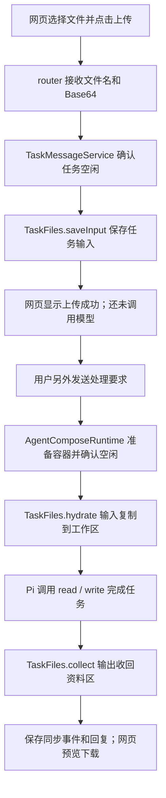

# 第 8 步：上传资料与任务文件归档

本步接通“把自己的资料交给 Agent，执行以后拿回结果”。上一轮能查看容器中已经存在的文件，这一轮增加上传入口，并将任务保存的资料与容器执行副本分开。

## 一、先理解为什么要有两份目录

把网页任务想成一项需要长期保留的工作，容器是为这项工作临时准备的计算机。

- 任务资料区保存用户交来的输入和已经收回的输出；任务还没有开始时也可以接收资料。
- 容器工作区供 Pi 的 read/write 工具实际操作。开始执行之前，把输入放进去；执行结束以后，把输出收回来。

服务器上的根目录始终是 `/home/hanwen/Project/project/siNRA-pi`：

```text
runtime/
├── task-files/<taskId>/             本轮新增：按网页任务编号保存
│   ├── input/values.csv             用户上传的原始资料
│   └── output/upload-result.json   从执行环境收回的结果
└── agent-compose/data/sandboxes/<日期>/<sandboxId>/
    └── workspace/                  已有：容器实际操作的工作区
        ├── input/values.csv         执行前复制进来
        └── output/upload-result.json  Pi 写入，再收回任务资料区
```

容器内看到的路径仍是 `/workspace/input/values.csv`。`workspace` 与容器是绑定挂载关系；`task-files` 与 `workspace` 是同步复制关系。网页任务编号 `taskId`、执行记录编号 `executionSessionId`、容器编号 `sandboxId` 各有用途，不能互换。

这样，资料的存在就不再要求容器已经启动。已成功归档的文件在执行目录暂时不可用时仍可读取，但网页会提示可能不是最新结果。这不是异机备份：两份文件仍在同一台服务器；也不是版本历史，同名输出保存最近成功收集的内容。

## 二、原仓库怎样做，我们对齐了什么

参考代码仍固定在 `67d275494c50f1e5c205b96b72a7b1623acfbe1d`，应用基准 `965c53fba4eaa23996f54aa0532c7f6e1064bfd8`。沿用接口与职责，独立编写实现，没有复制未明确许可的应用源码。

| 原仓库文件／入口 | 要解决的问题 | 学习仓库对应位置 |
| --- | --- | --- |
| `packages/task-core/workspace.ts` 的 `saveWorkspaceInput` | 保存上传输入，校验名称、大小和同名文件 | `packages/task-core/task-files.mjs` 的 `saveInput` |
| 同文件的 `synchronizeTaskWorkspace` | 输入放入 sandbox，输出收回 task-files | `TaskFiles.hydrate` 与 `collect`，明确两个方向 |
| `apps/api/router.ts` 的 POST files | 接收网页上传请求 | `apps/api/router.mjs`，请求仍是 `{name, contentBase64}` |
| `packages/task-core/task-message-service.ts` | 在执行前后安排同步，报告同步结果 | 同职责 `.mjs` 服务与运行时准备钩子 |
| `public/app.js` | 选择、上传、刷新、预览和下载 | `public/files.mjs` 管请求，`public/app.js` 管交互和展示 |

与参考保持一致的主要合同是：上传接口、每次文件内容最多 600000 字节、独立任务资料区、执行前输入同步、执行后输出收集，以及 `workspace_synced` / `workspace_warning` 事件。

本阶段明确保留的差异：网页一次上传一个文件；没有批量上传、文件删除、任务克隆、工具草稿和上下文 Markdown 生成。学习版还增加运行中上传的互斥检查、严格路径／链接检查、保存与同步分别报告、下载缓存提示。重复名称返回 409，超限返回 413。原仓库 GET 会执行双向同步，我们的 GET 仅收集结果和导入缺失的历史输入，不回写正在执行的容器。

600 KB 是本轮新上传的上限。为保留第 7 步已支持的历史文件读取能力，既有输入的导入、回填和下载仍允许到 50 MB；所有文件总量仍受 100 MB 和 1000 条目限制。不能将新上传限制误当成所有历史文件的读取限制。

## 三、按真实顺序读代码



### 1. public/index.html、files.mjs、app.js：从浏览器选择文件

`index.html` 在任务文件区域增加文件选择框、上传按钮和状态说明。选择文件只是在浏览器中选中它；点击“上传所选文件”才提交到服务器。上传成功以后，用户仍需要在消息框写明要处理哪个文件、做什么。

`files.mjs` 的 `uploadFile()` 读取文件原始字节，转成 Base64，发送：

```text
POST /v1/tasks/<taskId>/files
Content-Type: application/json

{"name":"values.csv","contentBase64":"...文件字节的编码..."}
```

Base64 只是把二进制内容变成 JSON 能携带的文字，不是加密。上传函数检查文件大小、识别服务器结果，不自动重试不确定的上传：断线时保存可能已经成功，应该先刷新核对，避免把重试当成首次上传。

`app.js` 将上传状态接入按钮控制。上传期间不能发送任务或结束任务，运行中和已结束任务也不能上传。同名文件不会被覆盖。任务切换和迟到响应仍由请求版本号防止串入其他任务。预览只显示纯文本，并根据 `X-Task-Files-Sync` 响应头提示当前内容是否来自暂存归档。

### 2. apps/api/router.mjs：HTTP 接口只负责接待和返回

`router.mjs` 接收 JSON 后调用 `taskMessages.uploadInput()`，成功返回 201 和文件元数据。它不自己决定何时启动 Pi，也不直接拼接任意服务器路径。

成功响应中的 `synchronization` 分清三种情况：

| 状态 | 已经发生什么 | 下一步 |
| --- | --- | --- |
| `unprepared` | 文件已保存，执行环境还没有准备 | 用户发送任务时再创建和同步 |
| `current` | 文件已保存，已有空闲环境也已同步 | 可发送任务 |
| `pending` | 保存成功，但即时同步尚未确认 | 明确显示提示，下次运行前再同步 |

保存成功以后即使同步失败，也不能谎称“上传失败”。否则用户重复上传同名文件会遭遇冲突，却不知道第一份已经保存在哪里。

原有 GET 列表、预览和下载接口保持不变；现在读取独立归档。文件操作纳入服务正常关闭时的等待范围，避免刚接收的上传因网页服务正常退出而被提前放弃。

### 3. packages/task-core/task-files.mjs：管理两份文件及复制方向

这是本步新增的核心文件，可以先只记住五个入口：

| 方法 | 直白理解 |
| --- | --- |
| `saveInput(task, payload)` | 把用户的文件保存到这个任务的 input |
| `hydrate(task)` | 把任务 input 复制到执行环境，执行前必须成功 |
| `collect(task)` | 将执行环境 output 收回任务 output |
| `list(task)` | 更新归档后列出任务文件 |
| `read(task, kind, name)` | 更新归档后返回某一文件的真实字节 |

输入以任务资料区为准。旧任务原本只有容器文件，会按需导入尚未归档的输入；已有同名任务输入绝不被容器中的版本覆盖。输出以这次从工作区稳定读取的内容为准，发生变化后替换相应归档文件。相同指纹的文件跳过复制，减少重复写入。

本步不做“镜像删除”：工作区缺少某个旧输出，不会自动删除已经归档的文件。文件列表代表最近保存的文件集合，不保证每一个都是本轮新生成的，也不保证多文件同时拍成一个原子快照。

`#queue()` 让同一个任务的文件操作依次完成，不让一次网页刷新插进半次上传和归档之间。这是单网页进程内的协调，不是多服务器分布式锁。

### 4. safe-file-tree.mjs 与 workspace.mjs：安全地操作真实磁盘

`workspace.mjs` 保留上一轮的任务归属核验、路径检查和稳定读取，并导出共享原语。新 `safe-file-tree.mjs` 复用这些能力，增加目录扫描、容量检查和原子文件发布。

写文件时先把完整内容写进随机临时文件，再发布到目标名称。新上传使用排他发布，避免覆盖；输出更新使用原子替换，避免读到只写了一半的文件。程序拒绝符号链接、硬链接和特殊文件，并检查读取前后身份、尺寸和时间是否变化。Linux 上用已打开的目录描述符锚定逐层操作；Windows 保留路径和身份核验，但不宣称具有完全相同的抗竞争能力。

这些是网页文件服务的保护措施，不等同于 Pi 工具的操作系统级沙箱，也没有为互联网多用户服务增加身份鉴权。

### 5. task-message-service.mjs：决定什么时候允许上传和同步

`uploadInput()` 先占住这个任务的上传操作，再让运行时确认执行环境确实空闲。不能只看网页按钮：用户可能刷新页面，或者上一次执行在后台还未确认结束，因此服务器也必须检查。

`#execute()` 把 `prepareWorkspace` 函数交给运行时。运行时准备好目录后调用它，输入复制失败就不提交模型。这避免用户以为 Agent 看到了新文件，实际上它读的仍是旧输入。

模型本轮结束后，再调用 `collect()`。成功发出 `workspace_synced`，失败发出 `workspace_warning`。模型执行是否成功、文件交付是否成功是两件事：模型已经正确回答，但磁盘暂时写不进去时，应保留真实回答并报告归档警告。

现有 SQLite 事件列有 CHECK 约束，因此两个新事件沿用外层 `progress_message` 存储类别，精确类型保存在 `payload.type` 中；实时 SSE 和历史显示都读这个实际类型。没有为加两个显示事件重建数据库。

结束任务依旧先确认运行停止、释放 guest，再从保留的工作目录收集文件，最后确认任务为 stopped。归档失败时允许重试结束，不静默宣称文件已交付。

### 6. agent-compose-runtime.mjs、runtime-router.mjs：把准备动作放到正确位置

`assertWorkspaceIdle()` 检查运行、初始化、取消、结束和未确认状态；已有 sandbox 时，查询控制端并且要求明确返回“没有活动运行”。查询结束后再次检查本地状态，避免等待期间任务已经改变。

真实运行顺序为 `ensureWorkspace → 远端空闲确认 → prepareWorkspace → RPC`。准备函数还返回输入文件名；运行提示最多列 50 个、总 JSON 长度不超过 8000 字符，不把全部文件内容塞进提示。Pi 仍需要通过 read 工具读取内容。

`runtime-router.mjs` 只把新上传能力交给 Compose；旧 SDK 历史仍沿用旧运行方式，不悄悄迁移上下文。

### 7. bootstrap.mjs：组装更新后的应用

这里将上一轮的 `WorkspaceFiles` 换成 `TaskFiles`，然后交给 HTTP 服务和任务服务。其他层仍通过相同任务接口交流，不需要重写数据库、聊天入口和 Agent Compose RPC。

## 四、验收方式与证据

学习样例放在 `examples/02-upload-task/values.csv`，内容为一列 `value`，三行数值 3、9、15。独立期待值为 count=3、sum=27、mean=9；它刻意与此前内置 numbers.csv 的 4/100/25 不同，可以发现 Agent 是否读错输入。

`scripts/verify-compose-upload.mjs <taskId> uploaded|completed|ended` 检查三个阶段，不发模型请求。`uploaded` 检查已归档且没有 guest、Pi 会话或运行；后两个阶段核对原生 Pi 工具顺序、独立统计、归档／工作区／HTTP 字节、同步事件和历史未被读取修改。`verify-compose-task-files.mjs` 也已改为以归档为校验基准，存在工作区时另外报告字节比较。

自动化检查：本轮累计 Linux 354 项全部通过、无跳过；Windows 350 项通过，4 项 Linux 专属检查跳过。新增验证覆盖真实磁盘／HTTP／SQLite、上传与结束竞争、拒绝链接和越界、同步方向、旧输入兼容、异常归档、预览缓存提示、迟到请求，以及原生轨迹中的自定义文件名称。独立代码复核发现的三个问题均已修复并通过回归检查。

真实验收于 2026-10-20 执行，结果分开记录：

| 检查 | 实际观察 |
| --- | --- |
| 浏览器上传 | 两个新任务均成功上传 13 字节 values.csv；上传后无 sandbox、无 Pi 会话、运行次数为0；可预览 |
| 重复上传 | 同名请求409，原文件未覆盖，网页显示明确说明 |
| 执行前回填 | 两个任务都创建独立 guest，归档、工作区、HTTP下载的 values.csv 字节和指纹一致 |
| 真实模型处理新文件 | 两次请求都被 MiniMax 以529 overloaded_error拒绝；原生记录均无工具调用，未产生3/27/9结果；成功链路待服务恢复后补验 |
| 已有输出归档 | 旧任务36ba635d-8b5c-44d2-a4fe-ec272564f5d6的真实 result.json 被收回独立归档；45字节、内容4/100/25，网页预览及真实浏览器下载均通过，下载SHA与服务器一致；不是本轮新模型结果 |
| 结束与保留 | 两个新任务均 stopped，guest数量0，控制端released，无活动运行；输入与失败记录保留、结束后仍可下载；两个原有guest仍在运行 |

首次任务 `624e3709-f5f8-422b-8ce7-a7c8e079d155`，复验任务 `a841937e-66a1-4010-bd2d-97fb3a58b7a1`。两次请求相隔约4分钟，均返回“当前服务集群负载较高”；没有继续自动重试，没有改密钥或模型配置。输入指纹为 `2700944daf71bd0ce3b75a5dbd9395cd85f65eacc358d2c458cbd1978340f585`。旧输出指纹为 `b62fa3ddc398457bbb243e0bbe7dbed5b4293f896eebbc4f8e1acdee587b03bf`。

私有证据在服务器 `runtime/compose-web/`：`upload-acceptance-uploaded.json`、`upload-retry-uploaded.json`、`upload-first-overload.json`、`upload-retry-overload.json`、`upload-retry-files.json`、`upload-legacy-archive.json` 和 `upload-releases.json`。完整测试报告为 `runtime/upload-step8-tests.log`。没有把会话原文或凭据提交到Git。

`completed` 验收脚本在两次模型失败时都按预期拒绝通过。代码与自动化验证已完成，真实模型成功读取上传文件、写入新结果并在结束后验收这部分仍待补验。服务恢复后应新建专用任务上传样例并发送README中的要求；保留本次两个失败任务，不修改它们的结果状态来冒充成功。

## 五、这一步完成以后，能力边界在哪里

Pi 原来已经有模型循环及 read/write。新增的是网页应用安排文件进入、执行和交付的机制。并没有增加专业 siRNA 软件、工具注册或自进化；也没有改动系统权限、Docker 配置或旧任务 guest。

下一步先补齐上述真实模型成功验收，然后沿原仓库 `packages/capability-platform/agent-tool.ts`、`pi-extension.ts` 理解“把一个确定的软件函数变成 Agent 可调用的工具”。先接通一个输入输出容易核验的小工具，再学习工具管理、验证和迭代。不要把本轮上传文件本身当成已经完成工具封装。

## 后续补验：第8步成功链路已经通过

2026-10-20继续第9步前，新建专用任务 `4f75f67c-a3ab-43b3-94a4-6f0e680334b0`，上传同一份13字节values.csv。MiniMax本次正常完成3次成功工具调用：读取values.csv、写入upload-result.json、重新读取结果。独立验收确认count=3、sum=27、mean=9，归档／工作区／HTTP字节一致，随后结束任务并确认运行环境释放，输入、输出和历史仍在。

`verify-compose-upload.mjs` 的uploaded、completed、ended均通过，私有汇总为 `runtime/compose-web/upload-success-next.json`。上文两次529失败是当时真实发生的历史，仍保留；本条补验不改写这些任务的状态或日志。第8步原本缺少的成功链路至此补齐，下一步实现见 [第一个MCP工具](13-第一个MCP工具.md)。
