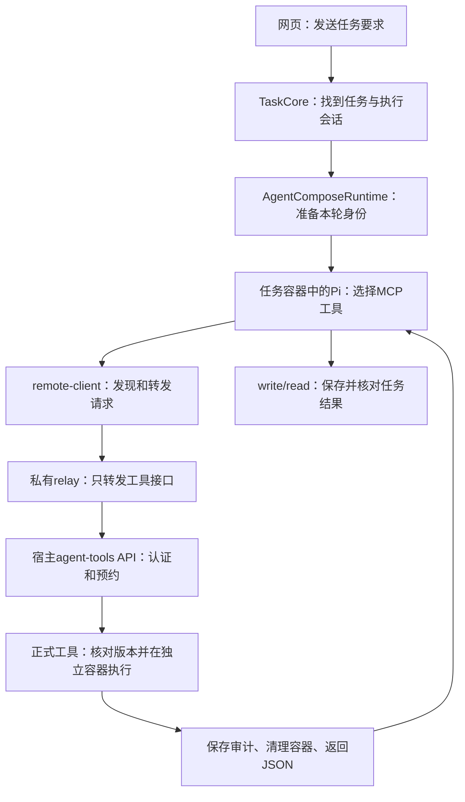

# 第10G步：让网页里的Pi调用已经批准的工具

本步完成：原先只能从宿主stdio MCP调用的`summarize_target_sequence@1.0.0`，现在能够被**新网页任务**中的Pi发现、调用，结果可以写入任务文件，调用审计能关联到具体网页任务及Compose运行。正式工具源码、版本、镜像和批准记录没有被替换。

先分清三件事：工具的代码已经写好，是“存在”；工具通过验证并批准，是“允许使用”；运行中的Pi能够发现并通过后端执行它，是“接通”。第10B至E步解决前两件，第10F步打通宿主调用，本步才补上网页任务这一端。

这一步仍属于工具封装与运行集成，尚未实现自动提出新版本、替换/回滚或自进化。

## 先看一条完整请求



Pi决定调用哪个工具、填写什么参数、如何使用结果；工具源码做确定性统计；后端程序决定是否允许执行、使用哪个正式版本、如何隔离和留证。大模型没有代替后端管理Docker，也没有通过读取登记库把源码加载到自己的进程。

## 与参考仓库如何对应

参考仓库只读基线为67d2754，其应用实现沿965c53f。以下是职责对齐，不是整文件复制：

| 参考实现 | 本步文件 | 为什么需要 |
|---|---|---|
| apps/api/router.ts中的/v1/agent-tools及/call | apps/api/agent-tools.mjs | 给任务容器提供正式工具的目录与调用入口 |
| src/mcp-server.ts的remote模式 | apps/mcp/remote-client.mjs、remote-server.mjs | 把Pi看到的MCP调用翻译为后端HTTP请求 |
| task-core/task-context.ts、workspace.ts | agent-runtime/task-tool-context.mjs、tool-call-leases.mjs | 把请求与当前任务绑定 |
| guest的pi-mcp-adapter刷新补丁 | containers/agent-compose-guest/patch-mcp-refresh.mjs | 更新已连接Pi适配器的工具缓存 |
| tool-proposals.ts的正式执行和审计 | tool-approved-execution.mjs、tool-run-audit.mjs | 复用上一轮执行内核，并增加任务关联 |

两个接口保持参考合同：GET `/v1/agent-tools`返回`{tools:[{name,label,description,inputSchema}]}`；POST `/v1/agent-tools/:name/call`接收`{arguments:{input:{...}}}`，成功仅返回`{content}`。固定领域工具仍在guest执行，正式工具由host执行。本步继续只支持JSON业务数据，不支持参考中的文件传输、其他运行类型或工具管理接口。

## 文件一：TaskCore把“哪项任务”告诉运行时

`packages/task-core/task-message-service.mjs`调用runtime.run时新增taskId。这个编号来自服务已经找到并预约的任务，不能由工具参数临时决定。

它还保存`approved_tool_call`事件。为了兼容现有SQLite事件枚举，数据库外层使用progress_message，payload.type保留真实事件类型；payload中有工具名、调用UUID、Compose运行编号及success。`public/app.js`把它显示为“正式工具调用完成/失败”。刷新网页后仍能看到同一个调用编号，不是只存在于一次动画中。

## 文件二：AgentComposeRuntime安排一轮的开始和结束

`packages/agent-runtime/agent-compose-runtime.mjs`现在按以下顺序执行：准备工作区并确认空闲→回填输入→生成稳定agentTurnId→建立本轮凭证并写上下文→提交RPC→收到onStarted后绑定真实Compose runId→让Pi工作→撤销新调用权限并等待已接受的工具→保存任务终态。

为什么多出agentTurnId？原运行时提交前先有一个本地UUID，Compose接受后会给出自己的runId。两者不能混用。本步保持稳定的agentTurnId描述“这轮准备”，agentRunId记录Compose真正接受的执行，toolCallId记录一次业务工具调用。

| 身份 | 表示什么 |
|---|---|
| taskId | 网页中的任务 |
| executionSessionId | 任务关联的执行会话 |
| sandboxId | 该会话的任务工作区与容器身份 |
| agentTurnId | 本轮请求准备阶段的稳定编号 |
| agentRunId | Compose接受后的实际运行编号 |
| toolCallId | 后端为一次正式工具执行生成的UUID |

新project才标记remoteApprovedTools。旧任务保留自己的project和镜像，describe会报告approvedToolsAvailable=false，继续运行时提示需要新建任务才能用正式工具。没有静默替换旧guest。

审查发现一个时序错误：如果用户在RPC已提交、onStarted尚未到达时停止，凭证已被撤销，再激活会抛错，把确认取消误记为failed。真实lease回归先复现失败，再修为取消后不激活、仍保留Compose身份和终态确认。

## 文件三、四：上下文文件与本轮凭证

`packages/agent-runtime/task-tool-context.mjs`只在当前真实workspace根下写`.sirna-task-context.json`，0600；拒绝路径跳转、硬链接、其他任务的旧文件。它保留参考`sirna-task-context/v1`及taskId，增加agentTurnId和随机token。正常结束先撤销凭证，再移除该文件；清理前核对字节，避免删掉较新的上下文。

该文件不在input/output内，不进入任务文件归档；内容不进入提示词、事件或Git。**guest本身可以读取它，因此不是对模型保密的凭据**。它只授予当前轮发现/调用正式工具的窄权限，不能用于管理Compose或模型账户。

`packages/capability-platform/tool-call-leases.mjs`在宿主内存保存随机32字节token与任务身份的绑定。HTTP必须同时带Bearer token、x-sirna-task-id及x-sirna-agent-turn-id；后端使用自己保存的身份，不相信调用方填写的session/run字段。参考原实现只核对task-id存在，本项目增加此认证扩展，是因为不能把任务标签当作访问授权。

pending阶段可以列出工具，正式业务必须等待真实runId激活。正常结束/取消撤销权限，服务重启后旧token全部失效。已接受执行由promise跟踪，即使HTTP断线也要完成审计与清理。普通结束等待它；取消会标记signal，但当前Docker runner仍是有界执行后清理，不承诺即时杀死工具进程。

## 文件五：后端只做正式工具的发现和调用

`apps/api/agent-tools.mjs`是独立HTTP server，不向guest开放完整网页API。它严格检查路径、方法、JSON、重复认证头、请求大小；正文只允许arguments，业务参数继续使用上一轮65536字节上限。

每次发现和调用都重新核对正式目录。所有HTTP连接共用一个busy预约，正在执行时拒绝另一个正式调用，不自动排队或重试。坏参数在执行前拒绝；对外失败提示固定，不回显宿主路径、stderr或审计私有内容。

`tool-approved-execution.mjs`仍执行同一个1.0.0候选容器，不重跑批准，不跑基线。新增taskContext传给`tool-run-audit.mjs`；两份审计因此同时知道正式包身份和网页任务身份。原stdio调用可不带taskContext，仍然兼容。

审批库不能判断某个网页服务和guest是否在线。因此管理信息的agentCallable改为null、callabilityChecked=false：表示没有探测部署，不能把批准状态自动写成“所有Agent都能调用”。本步网页可调用的证据来自实际验收。

## 文件六：为什么还有一个relay

网页一直只监听宿主127.0.0.1:3000。任务容器拥有自己的网络，不能把其中的127.0.0.1当作宿主。这里新增`apps/api/tool-api-socket.mjs`，让宿主工具API监听项目内`runtime/agent-tools/api.sock`，父目录0700、socket0600。发现已有socket时拒绝启动，不盲删可能仍在使用的入口。

`containers/agent-tools-relay/relay.mjs`在项目Docker私有网络内监听7420，把两个精确工具路径转给这个socket。它没有发布宿主端口；只读挂载relay源码和专用socket目录，不挂Docker socket、登记库或模型密钥。rootless容器中的0映射到宿主hanwen，用于访问私有socket，并不是宿主root授权。relay配置只读根目录、drop-all/no-new-privileges、128MiB/32进程。

`compose.yml`管理controller和relay；`agent-compose.yml`管理任务guest。两份文件不是同一职责。新guest是pi1.2.0-mcp2，新project是sirna-pi-learning-approved-tools；remote MCP通过显式环境变量访问`http://agent-tools-relay:7420`。`bootstrap.mjs`组装同一个lease/runner/server，并在正常关闭时等任务与正式调用排空。

`start-project-agent-compose.sh`现在同时启动controller与relay；prepare脚本检查新增私有目录。此次核对无活动任务后，重启项目网页进程并重建项目controller以刷新单文件bind的配置inode，两个旧guest未重启。没有修改系统服务、用户组或系统安装。

## 文件七：MCP为什么需要刷新两次

`apps/mcp/remote-client.mjs`每次读当前任务上下文，GET工具列表，把列表变成Pi熟悉的工具对象；执行函数再POST参数。它限制大小/期限、禁止重定向与自动重试，只接受公开文本结果。remote-server组装它和固定领域工具。

`apps/mcp/approved-server.mjs`可选每2秒轮询并发tools/list_changed通知。可Pi前面还有官方pi-mcp-adapter的缓存：只通知MCP客户端，并不保证模型的工具列表更新。`patch-mcp-refresh.mjs`因此对精确2.11.0增加通知接收、缓存/元数据更新，以及搜索、列表、未知工具回查刷新；失败不继续使用旧目录。

补丁独立实现，所有版本/唯一锚点在第一次写入前检查，变化即中止构建；原上游MIT许可保留在镜像，仓库另存pi-mcp-adapter-LICENSE供测试片段的许可追溯。

`scripts/verify-guest-approved-mcp.mjs`通过真实Pi加载器、真实适配器及真实remote MCP进程测试。临时HTTP夹具先只给固定工具，再新增工具、调用一次、移除工具；同一个MCP进程全程未重启。这个检查没有调用模型，也没有执行正式工具容器，不能与下一节业务验收混淆。

## 实际验收结果

网页任务ea1eb12d-3aa9-44ad-b943-5e9f1ef966f5通过浏览器创建和发送，输入AACCGGGUUUA；模型使用MCP实际发现到带前缀的sirna_tools_summarize_target_sequence并调用一次，随后write/read。

```json
{"length":11,"gcFraction":0.45454545454545453}
```

独立计数为A=3、C=2、G=3、U=3，所以长度11，GC=(2+3)/11。46字节输出含末尾换行，文件SHA为91a08439329ea14c1af35f264a6cc6766a3afca042fce4aea1300adc7cfc1b2d。工作区、独立归档、HTTP下载完全一致。

实际6次模型响应、6次Pi工具操作（4次MCP操作，包括连接/查询/正式调用，加write/read），其中只有1次正式业务执行。工具调用UUID为7b77c97f-34ee-44c7-a52a-52404383de1c；Compose run为55dac5e39d98e19abfaefb4030517438350182c09cf93e6d6e7b1cceaf3cd1f8。审计taskContext逐项与任务/会话/运行记录匹配，正式版本仍为toolId977b9593…、1.0.0、包SHA4e259ca6…。

正式工具容器确认不存在；结束网页任务后guest为stopped/released，文件仍能下载。原10份会话元数据字节、两个旧guest身份、正式材料/登记以及凭据文件元数据保持一致。当前4个运行容器是controller、relay及两个旧guest。网络无模型验收确认guest匿名访问工具入口401、访问任务API404；relay无公开端口和敏感挂载。

**真实限制：模型最后的自由文字说明把C写成3、U写成2，并出现“3+3=5”的错误；它报告的长度11和GC比例5/11、工具JSON及文件是正确的。没有改写这段模型回答，也没有追加付费请求掩盖问题。** 验收证明调用、绑定、执行、归档和释放链路，不认证模型整段解释。该例也不是siRNA活性预测，更不是自进化有效性证据。

累计974项测试：Windows961通过/13项平台跳过，Linux972通过/2项Windows专属跳过，均0失败；新增32项。初轮全套与开发中的轮询关闭修复重叠，出现一次poll-close失败；冻结实现后重跑全套通过，测试等待上界3秒仍显著短于网络30秒期限。独立审查的relay启动遗漏和pending取消两项P2均修复并复核，后续24项网页/文件回归也通过。元数据可调用性纠正另有定向回归，见最终日志。

只读验收命令（服务器项目目录，已有Node24）：

```sh
node scripts/verify-compose-approved-tool.mjs ea1eb12d-3aa9-44ad-b943-5e9f1ef966f5 ended
```

它核对原生MCP参数/结果、唯一正式调用、审计版本身份、三个文件副本、临时容器不存在及guest释放；不会新建任务、执行工具或调用模型。不要用第10F步的write/execution验收脚本来重复检查。

私有证据：runtime/web-approved-{state-before,network,completed,ended,local-tests,linux-tests,adapter-check,sync}及web-approved-browser.jpg。正式代码与学习说明同步main；会话、数据库、运行日志、凭证和截图不进入Git。

## 下一步如何学习

现在已经有“提案→构建→登记→独立验证→批准→被网页Agent使用”的首版闭环。下一步沿原仓库学习parent版本关系：针对已知失败提出新候选，用原版本作基线，验证后形成下一版本，并明确当前版本选择与回退。自动发现失败、自动生成改动、自动判定改进是否可靠，应在这些版本基础明确后再进入；不能把本次接通工具称为工具已经自我进化。
