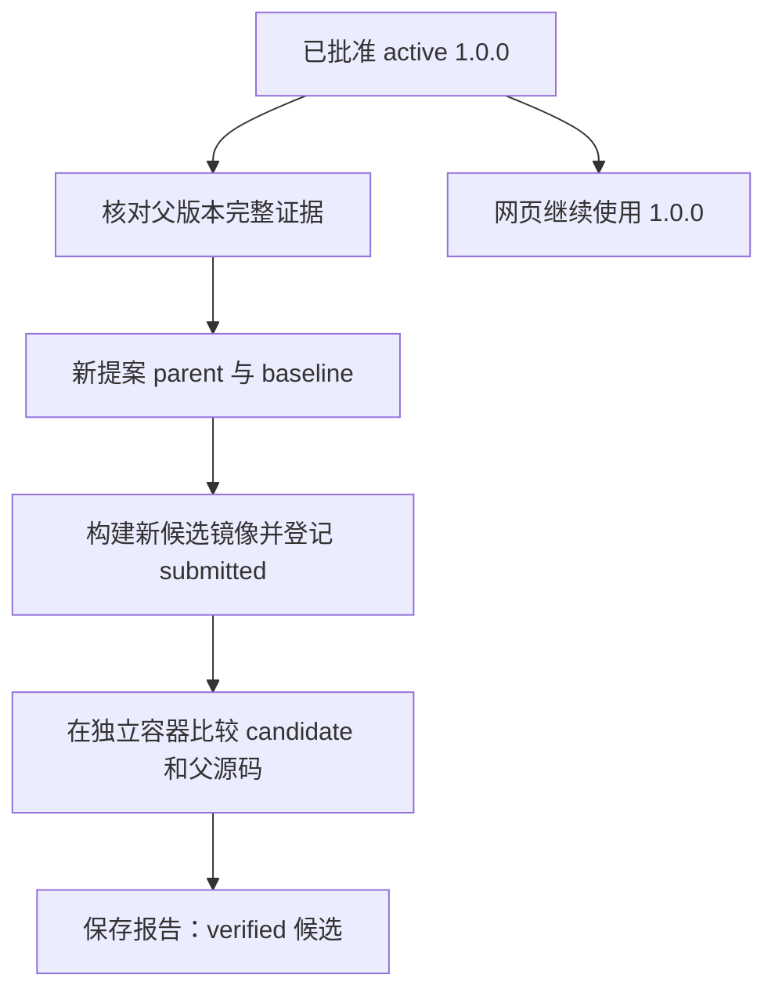

# 第10H步：让改进候选明确“从谁改、与谁比”

本步完成parent改进提案、真实父版本源码绑定和一次独立验证。新候选4530af22-d8d7-42f0-ac75-fec6ce851466已是verified；正式目录仍是summarize_target_sequence@1.0.0，尚未产生1.0.1，也未切换网页工具。全程0模型调用。

## 为什么先做这一步

第10G步已经让网页Pi使用正式工具，但“能用工具”和“能有依据地改工具”之间还差一个问题：新代码从哪份旧版本改来、比较时到底跑的是哪份代码？

parent回答“来源版本是谁”；baseline回答“本轮与什么程序比较”；benchmarkCases回答“按照哪些输入及预期结果比较”。这三件事不能相互代替。只填写parent不保证baseline是真实父版本，只通过自己填写的案例也不证明普遍更好。

本轮最小闭环：



## 原仓库怎么做，我们复现到哪里

参考仓库只读基线67d2754。正式packages/capability-platform/tool-lifecycle.ts:754检查：已有同名工具必须提供同名且存在的parent；全新工具不能凭空声明父版本。tool-proposals.ts:610/619分别保存baseline来源及parent，后者进入manifest，前者进入baseline脚本与SHA。原registry另外保存parentToolId/parentVersion。

原仓库的baseline由提案提交者提供，**没有自动等于父版本源码**。本学习仓库这轮加入额外约束：只支持当前active/retained的1.0.0父版本，baseline.runtime及源码必须与完整读回的正式父版本一致。此约束为学习过程提供清楚的比较对象，不称原仓库已有同样机制。

当前parent关系保存在冻结manifest及整包摘要中；验证报告另外保存父toolId、包/镜像/源码摘要。没有迁移数据库或添加多版本列。原仓库下一阶段的nextVersion、active/inactive切换和rollback尚未复现。不要误读旧低层固定1.0.0出版函数为原仓库不支持版本迭代；正式版本规则在tool-registry.ts:767，手动回退在:843及tool-lifecycle.ts:1533。

## 一、具体改进：把计数交给确定性代码

新增examples/05-parent-tool-proposal/proposal.draft.json。它保持同一个toolName，明确指定：

```json
"parent": { "toolName": "summarize_target_sequence", "version": "1.0.0" }
```

候选仍输出length和gcFraction，另加baseCounts:{A,C,G,T}。源码先沿用旧版去FASTA标题/空白、转大写、U转T，然后单次遍历计数：

```js
const baseCounts = { A: 0, C: 0, G: 0, T: 0 };
for (const base of sequence) baseCounts[base]++;
const gcCount = baseCounts.G + baseCounts.C;
```

因此输入AACCGGGUUUA得到：

```json
{"length":11,"gcFraction":0.45454545454545453,"baseCounts":{"A":3,"C":2,"G":3,"T":3}}
```

T=3包含原输入的U=3；这是归一化后序列的计数。旧1.0.0没有counts字段是原功能边界，不是旧长度或GC算法算错。新增数据能减少模型凭空计数的需要，但本轮没有测试模型是否会正确引用这些字段，不能声称已修复Pi的自由解释错误。

baseline复制的是examples/04-tool-contract/proposal.draft.json中的旧candidate源码，**不是那份文件里的更弱baseline**。服务会再与正式包核对，因此文件看起来相似不足以通过提交。

## 二、tool-proposals.mjs：把父关系冻结进材料

原来材料层直接拒绝parent。现在createToolProposal和readToolProposal允许可选parent，要求与当前toolName相同，并在manifest往返中保留它。parent参与已有整包SHA，事后修改父版本字段会使摘要不匹配。

包仍只有manifest.json、tool.mjs、baseline.mjs三个文件；manifest仍是draft/0.1.0-draft。提案草稿版本不是未来正式工具版本。旧无parent包的字段顺序、字节与摘要没有重写。

## 三、tool-lifecycle.mjs：关联到真实的已批准父版本

submitRegisteredToolProposal先只读现有目录和registry，再判断已有同名正式工具是否需要parent。新增assertRegisteredToolParent会：

1. 核对同名、1.0.0存在且active/retained。
2. 复用readRegisteredToolVersion核对正式包、源提案、验证报告、批准身份和摘要。
3. 核对baseline运行类型及源码SHA与已校验的正式源码一致。
4. 返回完整parentComparison，包含toolName/version/toolId/packageSha256/imageDigest/scriptSha256/baselineScriptSha256/comparisonMode。

comparisonMode固定registered-parent-source。缺父版本、弱基线或损坏正式包在写入新材料/登记前被拒绝；SQLite可能建立空WAL/SHM协调文件，不代表新增提案。已批准首版的历史读回不适用“已有同名工具必须填parent”的新提交规则。

## 四、tool-validation-service.mjs：运行前后核对同一个父版本

验证开始前解析完整父绑定，才把冻结材料交给runner。候选与父源码仍按同一输入分别运行，沿用静态、语法、重复性、领域案例及基准净增益门禁。结束后再次核对父证据，并与最初完整绑定比较。

仅仅“结束时还能读到一份有效父包”不够。如果包、toolId或镜像身份被替换，即使替换后的包自身完整，也不能继续把本次比较写成原父版本的验证通过。新增测试覆盖了这类身份替换。

本轮baseline在固定验证基座中运行父版本源码；candidate在新构建镜像中运行。报告中保存父imageDigest用于追溯，**不表示基线业务直接运行在该父镜像中**。这也不构成任意软件依赖环境的完整复现。

## 五、tool-validation-reports.mjs与tool-approval-service.mjs：保存证据，不自动发布

正常报告读回除核对报告SHA/数据库记录，还读回原材料，重新解析parent并比较parentComparison。缺失绑定、字段错误或额外字段均拒绝。旧无parent报告继续兼容。

保留一个必要区别：如果旧报告明确passed=false且artifactIntegrityPassed=false，它仍可作为“材料损坏诊断”读取；不能将这类诊断读回称为材料完整性认证。show路径仍严格检查材料。

approve入口明确拒绝parent提案，并在任何批准写入前返回错误。verified只表示本次验证门禁通过；approved和active分别属于后续批准和当前版本选择。本轮正式版本数仍为1。

## 六、真实验证结果与边界

构建ID d09c8565-156f-466e-927b-86810119b6f5；新镜像sha256:c2a82b28889e5ccba46baa68647422614be1467c6e312ec2bced38c6ce94aa47。构建冒烟1次、成品案例3次，共4次业务执行。

登记提案4530af22-d8d7-42f0-ac75-fec6ce851466；独立验证d998793a-5021-460a-9276-6d2adff6647c。验证业务共11次：两次重复性、三个领域案例、三个基准各跑候选与基线。另有两次只检查语法的容器操作。

| 基准 | 候选 | 父源码 | 原因 |
|---|---|---|---|
| ACGT，只要求原length/GC | 通过 | 通过 | 原合同保持 |
| AACCGGGUUUA，要求完整counts | 通过 | 未通过 | 父源码没有新字段 |
| FASTA小写多行ggccau，要求counts | 通过 | 未通过 | 父源码没有新字段 |

候选3/3、父源码1/3、净增2，门槛1；领域3/3、双次重复性、材料及镜像来源通过。基准是事先明确的功能扩展案例，不能解释为独立泛化、生物预测准确率、普遍算法优势或自动自进化。

父源码与baseline逐字节相同，SHA均3bb9f0ca3237100e9ceb7e182939ed731fc6a68b9f1c1251bf6ffb577193d8ac；候选源码SHA de66eebcc0faec7dda0cc05e599403a45d3fe7e6fe7c632591cd8193097afb2a。提案包SHA73c8c245…，报告SHA6c643791…，完整摘要保存在私有验收报告。

本轮新增21项测试；995项全套中Windows982通过/13跳过、Linux993通过/2跳过，0失败。17项父关系测试及4项实际示例源码测试，独立Task1审查和最终整体复核通过；最终复核覆盖示例、只读验收器和证据表述，没有再次执行业务或模型。首次错误使用裸node --test，误扫runtime内历史/供应商测试，45项失败主要为缺少其依赖；日志保留。按package.json声明的tests/*.test.mjs范围重跑通过，未为该调用错误修改产品代码或安装依赖。

只读验收入口scripts/verify-parent-tool-proposal.mjs检查真实报告、父源码字节、新镜像及业务容器清理：

```sh
node scripts/verify-parent-tool-proposal.mjs 4530af22-d8d7-42f0-ac75-fec6ce851466
```

该命令不重新构建/验证/执行工具或调用模型。私有runtime/parent-tool-{state-before,build,submit,validate,acceptance,local-tests,linux-tests,sync}保存本轮证据；原始源码/运行报告按既有私有目录保存，不提交真实日志或数据库。

核对原有9个材料文件、旧登记行、正式catalog、11份会话元数据、4个运行容器及凭据文件元数据保持不变。17个新建临时容器（4个构建、11个验证业务、2个语法检查）均已移除；候选镜像和证据保留。只新增1提案、1验证、2事件；schema仍3。没有重启服务、修改系统设置或调用模型。

## 下一步

围绕已verified候选实现多版本批准：保存parent关系到版本登记，分配1.0.1，旧版转inactive而保留材料，再实现明确的人工切换/回退和目录刷新。应先补齐事务与历史包完整性检查，再实际改变网页的active版本。本轮没有自动提出候选、自动批准或自动替换功能。
