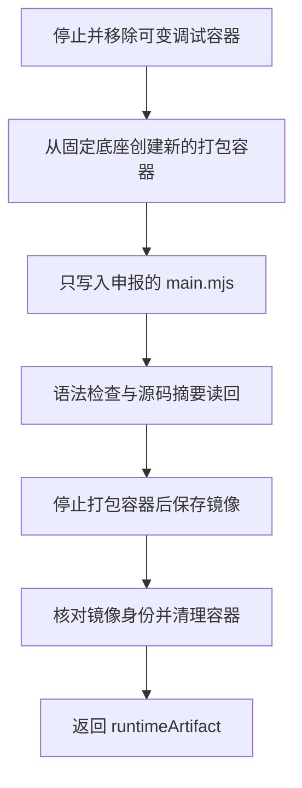

# 第10J步：让 Agent 通过工具接口构建工具、提交候选

本步已把之前只有可信命令行入口的“构建、提交”，拆成 Agent 能调用的六个操作，并通过真实MCP客户端和Docker完成一次候选提交。实现的是独立宿主 MCP 服务，暂未连接网页 Pi，也没有自动 Curator。新候选仍为submitted；原正式工具保持1.0.1。

## 为什么轮到这一步

前面已完成“一个候选怎样变成正式工具”：合同、容器产物、材料登记、独立验证、批准、发现调用、版本发布和人工回退。此前仍要人先准备完整草稿，再通过命令行一次性构建。

Agent 需要交互式流程：先得到一个构建环境，再写代码，运行一次、看输出，必要时改代码再试，最后固定下来提交。因此本步新增的是“Agent 操作这条生产流程的接口”，不是重新写一个大模型，也不是重写 Pi。

工具在这里有两层含义。`write_tool_build_file` 是帮助 Agent 造工具的操作；`summarize_numeric_values` 是被造出来的候选业务工具。Agent 调用前者提交源码，后端程序才实际执行文件和 Docker 操作。

## 原仓库怎样处理

参考固定本地基线 `67d275494c50f1e5c205b96b72a7b1623acfbe1d`，没有更改参考仓库。

| 原仓库文件 | 职责 | 本轮学习实现 |
| --- | --- | --- |
| `packages/domain/sirna-tools/sirna-tools.ts` | 定义构建操作的名称、说明、参数，调用客户端 | `packages/domain/sirna-tools/tool-builder-tools.mjs` |
| `packages/capability-platform/tool-runtime-client.ts` | 转发到构建控制端HTTP接口 | 当前宿主MCP直接调用service；远程构建转发留到下一步 |
| `packages/capability-platform/tool-runtime-controller.ts` | 创建、执行、写文件、取消、冻结构建容器 | `packages/capability-platform/tool-build-sessions.mjs` |
| `src/mcp-server.ts` | 将这些操作提供给Agent | 独立的 `apps/mcp/tool-builder-server.mjs` |
| `packages/extensions/tool-curation/tool-curation-coordinator.ts` | 从任务轨迹判断是否值得造工具，协调后续工作 | 尚未实现，不是本步调用接口的前提 |

原仓库的核心六个名字和参数层次保留：创建传空对象；命令是字符串；冻结命令是数组；提案字段平铺。并非把提案放进一个新的 `input` 外壳。

原实现允许更通用的构建命令、安装依赖及保存构建容器文件系统。本轮只开放 Node、无额外依赖、离线、单个源码文件，调试命令以非root用户执行。最终从固定底座重新打包申报源码。这是明确的学习子集，不称已完整复制原控制器。

## 文件一：tool-builder-tools.mjs，告诉 Agent 有什么操作

`createToolBuilderTools({service})` 返回六个工具描述。每个描述包括名称、用途、参数JSON结构和 `execute` 函数。模型依据名称和说明选择操作、组织参数；`execute` 再调用实际服务。

| 操作 | 主要参数 | 实际作用 |
| --- | --- | --- |
| `create_tool_build_session` | `{}` | 新建隔离的构建环境，返回会话编号 |
| `write_tool_build_file` | `sessionId, path, content` | 写入唯一允许的 `/opt/tool/main.mjs` |
| `run_tool_build_command` | `sessionId, command, timeoutMs?` | 在这个环境中运行命令并返回退出码、输出和错误输出 |
| `cancel_tool_build_session` | `sessionId` | 取消未完成构建并核对容器清理 |
| `finalize_tool_build` | `sessionId, command` | 把申报源码变成固定镜像，返回产物身份 |
| `propose_exploration_tool` | 完整提案，包括 `runtimeArtifact` | 保存候选材料并登记submitted |

`sessionId` 是此次临时构建的身份；`imageDigest` 是冻结镜像的身份；`proposalId` 是候选登记的身份。它们都不是网页任务编号，也不是正式工具版本号。

## 文件二：tool-build-sessions.mjs，让操作真的发生

这个文件是本步的核心。`createToolBuildSessionService` 管理本进程创建的会话，拒绝其他进程/不存在的会话编号。写入、运行、取消、冻结和提交统一串行；已有操作进行时，第二个修改请求得到busy，不会交叉修改同一环境。

`create()` 先建立私有证据目录，再向项目Docker申请容器，检查实际镜像、标签和隔离配置，启动它。容器不挂宿主目录或Docker socket，没有外网，内存上限1GiB、进程数上限64；CPU配额仍未施加。构建容器根文件系统可写；后端固定的保活、源码写入和语法/摘要检查以容器内root运行，Agent提供的任意调试命令始终以65534用户运行。这里没有使用宿主管理员权限。

`write()` 只允许精确路径 `/opt/tool/main.mjs`，最大200000个UTF-8字节。主源码由root持有；普通调试用户不能替换解释器或覆盖该源码。每次写入更新源码摘要，并使先前的调试成功记录失效，避免“测过旧代码，换了新代码却直接打包”。

`run()` 把字符串交给容器内 `/bin/sh -c`，不是交给服务器宿主shell。命令最大20000字节，默认10秒，范围100毫秒到30秒；stdout与stderr合计最多65536字节。退出非0可以继续编辑；超时、传输异常或输出超限会使会话失败，并尝试清理。成功退出只说明这一条调试命令成功，不能当作独立验证通过。

`finalize()` 要求有源码，且该版源码写入后至少有一次成功调试。它执行以下顺序：



为什么多一个打包容器？调试时可能产生 `/tmp` 文件或后台进程。直接保存原容器，可能把未申报的状态一并带入工具。新的容器仅接收指定源码，候选镜像不继承调试中的临时修改。源码本身仍可以有错误，后面的独立验证关卡依然必要。

相同冻结请求返回同一个产物，不再建镜像。`propose()` 要求产物来自当前服务实例，源码与冻结源码逐字相同，且完整提案合同有效；随后复用既有 `submitRegisteredToolProposal` 保存材料并登记。相同提案重复调用读回同一编号；不同内容的重复提交拒绝。登记失败且结果不确定时，禁止自动重试，以免静默出现多个候选。

登记事件仍复用既有服务的 `local-cli` 来源标签；本轮构建会话和提案的关联另外保存在私有构建日志。这个标签不是用户认证，也不能当作已经实现网页任务身份追溯。任务身份绑定属于下一步远程接线。

会话默认闲置5分钟过期，每实例最多4个占用资源的会话、32个总会话。失败但清理未知的容器也占用容量，不能靠重复失败绕过限制。这不是全服务器跨进程配额。证据目录不会自动删除；进程重启后也不能凭证据目录直接恢复旧会话。

## 文件三：tool-build-service.mjs，复用原有运行规则

旧的一次性构建服务仍保留。本步只增加只读共享辅助对象 `toolBuildRuntime`，供新会话服务复用同一套配置、实际策略检查、标签归属检查和镜像身份检查。

这样不是再维护第二套“什么容器算合格”的规则。新冻结产物继续能被原 `executeToolArtifact` 使用，后续也可以进入前面已经做好的验证和批准流程。

## 文件四、五：MCP适配与可信入口

`apps/mcp/tool-builder-server.mjs` 把六个操作注册为MCP工具。MCP可以理解成Agent客户端和工具服务之间约定好的消息协议：客户端请求工具列表，再传名称和参数调用。适配器给出有界响应和固定错误文本；详细容器信息、宿主路径和诊断保留在私有证据中。

`scripts/tool-builder-mcp.mjs` 是启动入口。它只允许Linux用户hanwen在指定项目根目录运行，并显式连接项目自己的Docker socket；不能把这个入口搬进网页guest，让guest直接取得Docker控制权。标准输出专用于MCP消息，诊断走标准错误。

输入结束、SIGTERM或SIGINT会先等已接受的有限时操作结束，再清理归属当前服务的容器。若Docker创建响应丢失，后端可能不知道实际容器ID；此时明确保存“清理未知”，不会猜一个ID删除，也不会宣称全部清理完成。当前没有全局孤立容器扫描和进程崩溃恢复。

## 例子、测试和验收文件

`examples/06-agent-tool-build/proposal.draft.json` 是人为准备的数值汇总示例，用来观察流程。源码从标准输入信封取 `input.values`，计算数量、总和、平均值。它还保存测试案例和一个故意弱化的baseline，作为完整提案合同的一部分。本轮没有跑独立验证或baseline比较，因此没有净增益成绩。

`tests/tool-build-sessions.test.mjs` 使用临时目录、真实材料文件和SQLite测试会话及登记；只把外部Docker替换为可控测试替身，检查源码污染、伪造产物、清理失败、超时、过期、限额和幂等行为。`tests/tool-builder-mcp.test.mjs` 通过实际MCP SDK传输测试工具合同、忙碌拒绝、错误边界和关闭排空。所有CLI子进程显式使用临时cwd，避免上轮出现过的部署目录继承问题。

`scripts/verify-agent-tool-builder.mjs` 是可重复执行的只读验收入口：核对本轮证据、当前镜像、候选材料、旧登记行和旧工具目录，不再运行源码、提交候选或调用模型。私有 `runtime/agent-builder-exercise.mjs` 则是一次性写操作脚本，不能当只读检查重跑。

## 本轮实际验收

真实验收使用同一MCP客户端，共14次工具调用，其中5次故意传错参数。完整顺序包括创建、错误路径/未知会话拒绝、写源码、调试、冻结及重复冻结、伪造镜像/源码不符拒绝、提交及相同重复、冲突重复拒绝，最后创建第二个会话并取消。

| 检查 | 实际结果 |
| --- | --- |
| 构建容器内调试 `[2,4,6]` | `{"count":3,"sum":12,"mean":4}`，命令先检查当前用户是65534 |
| 冻结镜像在新容器运行 `[-2,2]` | `{"count":2,"sum":0,"mean":0}` |
| 成品文件系统检查 | 源码摘要匹配，`/tmp/build-only-marker`不存在；检查容器没有挂tmpfs，避免仅因挂载遮住原文件而误判 |
| 临时容器 | 调试、打包、独立执行、镜像检查、取消演示共5个，均确认已移除 |
| 新镜像 | 恰好1个，原镜像集合完整保留；重复冻结未增加镜像 |
| 登记变化 | 恰好1个submitted提案和1条proposal_submitted事件；0个新验证、0个新正式版本、0次正式工具调用 |
| 旧状态 | 18份材料、12份调用审计、11份会话、4个原运行容器、任务表及目录保持；凭据只核对元数据 |
| 模型/网页 | 0次模型请求；没有新Pi对话，不重启现有网页服务 |

新提案编号 `f94f2783-6dd5-4dfe-b725-3efd24764cc2`，名称 `summarize_numeric_values`。镜像为 `sha256:ef051b2a755d16a5b30d4ae7bc2a811449fb403857383f07ebbde7a684152e7c`；提案材料包SHA为 `9307b48a4507472f87239aa925920013483ab5a5b4c5922717f6e1ace11694a4`；源码SHA为 `52007e56223c16bf91ae3a495c8cba11e80d805c83ea7a32e8622057d026b406`。这些标识绑定本次运行材料，不是预测性能分数。

新测试18项。Windows完整回归1041项：1028通过、13项既有平台/权限跳过；后续仅修测试清理函数，18项定向回归通过。最终Linux完整回归1041项：1039通过、2项Windows专属跳过，0失败；修正后的Linux相关47项也全部通过。产品代码在首次完整回归后未改动。

第一次Linux完整回归为1037通过、2失败、2跳过：两个新测试的业务断言已完成，但删除只读临时提案目录时after hook报EACCES。修复只作用于测试夹具：限定临时根目录、不跟随符号链接，解锁自建材料后清理，不放宽正式包权限。原失败日志和两个失败临时目录保留。聚焦47项通过后，一次私有收尾健康检查因同步等待测试期间HTTP长连接关闭而失败；只读重查确认服务正常，检查脚本改用不复用连接，最终整套检查通过。没有为这些问题重跑候选构建或模型。

独立核心代码审查通过。操作脚本初审另外修复了清理异常仍需落盘、stderr回调不得直接抛出，以及Git归档覆盖前核对内容三处问题，并完成复审。

服务器可重复执行只读检查：

```sh
cd /home/hanwen/Project/project/siNRA-pi
node scripts/verify-agent-tool-builder.mjs
```

私有证据在 `runtime/agent-builder-state-before.json`、`agent-builder-exercise.json`、`agent-builder-acceptance.json`、`agent-builder-fresh-run.json`、`agent-builder-inspection.json`、本轮各调用记录以及 `runtime/tool-builds/<sessionId>/events.jsonl`。它们不进入Git；Git仓库保留实现、样例和学习说明。此检查固定本轮最终状态；未来验证/批准该候选后，不能继续要求旧的submitted断言通过。上轮第10I只读检查固定当时的提案总数，本轮新增候选后也不再适用，不改写历史证据。

## 如何理解完成范围和下一步

本步完成后，程序客户端可以用和Agent相同的六个工具合同发起构建和提交。它证明接口、容器和登记流程能连起来；不证明Pi本轮自主决定造工具、写出了这份源码，也不证明自进化有效。

下一步应沿原仓库的远程构建客户端/控制端，把这些操作接入已有网页任务身份和能力凭证，确保任务只能管理自己创建的构建会话，再做一次真实Pi调用。之后才接Curator：它读取任务轨迹，判断何时值得构建或改进，组织调用这些能力。正式验证、批准和上线继续与候选生成分开。
