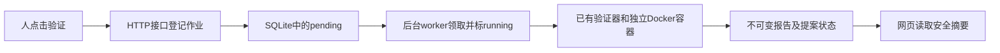

# 第10L步：在网页提交工具验证，并理解后台维护作业

## 1. 这一步解决什么问题

上一轮 Pi 已经在网页任务中构建了 `summarize_numeric_range`：输入一组数，返回数量、最小值、最大值和范围。材料和镜像都保留下来了，提案状态是 `submitted`，即“已经提交”。但网页还没有让人查看这些候选、发起独立验证的入口；已有验证器只能通过可信 CLI 运行。

本轮把这段流程接成网页功能：人打开候选面板，明确选择一个提案验证；服务记录一份作业，后台领取作业，在新的隔离容器里检查候选；网页读取已保存的报告。

可以把它理解成“交作业、排队批改、查看批改结果”。模型提交候选相当于交作业；模型自己的调试不是独立批改。网页也不会自行判断答案正确，而是显示验证器保存的证据。



`worker` 就是专门领取和执行后台作业的程序。这里不会增加新的大模型角色，也不会向 MiniMax 发送请求。

## 2. 先纠正上一轮对 Curator 的称呼

深入核对原仓库后，需要修正上一轮下一步描述中把所有工具协调统称为 Curator 的说法。参考基线为 `67d275494c50f1e5c205b96b72a7b1623acfbe1d`。

| 原版部分 | 它回答的问题 | 对应文件 |
| --- | --- | --- |
| Curator | 从已发生的任务轨迹看，缺少什么可复用能力？ | `packages/extensions/tool-curation/tool-curation-coordinator.ts`、`agent-tool-curator.ts` |
| 普通执行 Agent 和 builder | 如何真正写出、调试并提交这个工具？ | `tool-curation-build-prompt.ts`、builder工具 |
| tool automation | 提案已提交，下一步验证、修复还是批准？ | `apps/api/router.ts` 中 `processToolAutomation` / `processAutomationRun`、`packages/capability-platform/tool-automation.ts` |
| maintenance worker | 谁实际领取验证或批准作业？ | `packages/capability-platform/tool-maintenance-worker.ts` |

Curator 输出的是能力建议，不是已经验证的工具。原版还会自动排批准作业并激活合格工具；并不是原版自带人工批准门。个人学习版继续保留人工批准，是主动收紧的范围。

本轮实现的是 maintenance 这一层和网页入口，为以后的 automation/Curator 准备基础。不是完整自动修订循环，更不是“自进化已经有效”。参考代码只读，没有修改，也没有整段复制进学习仓库。

## 3. 先分清三种记录

| 记录 | 意思 | 典型状态或内容 |
| --- | --- | --- |
| proposal，提案 | 要检查的那个工具是什么 | submitted → verified 或 verification_failed |
| job，维护作业 | 这一次验证请求执行到哪里了 | pending → running → succeeded / failed；崩溃遗留可为 interrupted |
| report，验证报告 | 实际检查发现什么 | 源码/镜像、重复性、测试案例、基线成绩、净收益 |

最容易混淆的是 `succeeded` 与 `passed`。前者说“批改流程正常做完了”，后者说“被批改的工具符合所有约定”。一个工具测试失败，但验证器完整保存了失败报告，其作业仍是 succeeded；提案则是 verification_failed。Docker或证据写入等基础设施异常，才是作业 failed，不能伪造一个普通测试失败成绩。

浏览器收到 HTTP 202，只说明请求已被接受，不说明已经运行完，更不说明通过。页面会再用 GET 查询结果。刷新页面不会重新 POST 一次验证；一次请求的 UUID 幂等键用于识别网络重试，避免相同请求重复排队。

## 4. 文件怎么配合

### 4.1 网页负责表达人的选择

`public/index.html` 新增全局“工具候选与独立验证”区域。它属于整个工具库，不能随着选中聊天任务而被误认为那一个任务的文件。

`public/tools.mjs` 的 `createToolPanel` 管理列表、选中提案、正在提交的请求和摘要；`mountToolPanel` 把数据画到页面。点击按钮时，它先把本次请求 UUID 保存到浏览器 sessionStorage，再 POST；如果响应丢失，重试沿用同一 UUID。收到明确响应后才移除该编号。普通刷新只发 GET，不运行候选。动态文本通过 textContent 显示，不把工具名或文本当成 HTML 执行。

### 4.2 HTTP 接口只收请求、回状态

`apps/api/router.mjs` 新增三条路径：

| 请求 | 输入 | 输出 |
| --- | --- | --- |
| `GET /v1/tool-proposals` | 无 | 候选状态、最新作业及队列可用状态 |
| `POST /v1/tool-proposals/:id/validate` | `{ "requestId": "一个UUIDv4" }` | 202、job、是否复用了已有请求 |
| `GET /v1/tool-proposals/:id/validation-summary` | 提案编号 | 无报告时null；有报告时返回经过核验的摘要 |

它沿用已有回环地址、Host、Origin、请求体限制。网页不能传入源码、镜像、执行命令或 passed=true 来改变这次检查；它只能指明已经登记的提案编号。原版请求中有requestedBy，个人版新增requestId解决网络重试，并且不让网页自报可信角色。

### 4.3 作业表负责“记得这件事”

`packages/capability-platform/tool-maintenance-store.mjs` 的 `ToolMaintenanceStore` 把作业保存在 `runtime/tool-maintenance/jobs.sqlite`。这里的 jobs 记录执行状态，requests 把请求 UUID 绑定到作业。即使验证已经结束，同一请求 UUID 再来，也会指向原来的那份结果。

同一个候选已有 pending/running 时，新请求会复用已有作业；一个请求编号不能用于两个不同候选。领取时使用 SQLite 事务，数据库约束只允许一个 running。排队容量为100个未完成作业。材料摘要在接受时绑定，在开始前再次核对，避免排队期间候选被替换。

已有 `runtime/tool-registry/registry.sqlite` 继续保存提案、报告索引和正式版本，schema仍为4；新作业库不是替代旧库。

### 4.4 worker 决定何时执行，不决定工具是否正确

`packages/capability-platform/tool-maintenance-worker.mjs` 的 `createToolMaintenance` 提供 enqueue、start、summary、stop 等操作。enqueue 检查当前提案是否可验证；后台循环领取一个作业，重查材料后调用验证器；完成后再领取下一个。

`summary` 复用原有报告读回逻辑核对文件摘要、提案编号和登记状态，再挑选固定字段给网页。完整 stdout、stderr、源码、容器编号和服务器路径仍保留在私有证据里，不直接铺到网页。

`packages/capability-platform/tool-maintenance-validation.mjs` 的 `createMaintenanceValidator` 为每个作业建立 `runtime/tool-maintenance/runs/<jobId>/`，保存 request.json、events.jsonl 和 result.json 或 failure.json。容器创建与清理事件写入日志并fsync，作业结果与验证报告通过 validationId 对应。

生产执行器发生基础设施异常时，会持久暂停队列；重启也不会自动解除。尤其不能在容器清理结果未知时继续不断启动新容器。修复需先检查私有证据，本步没有“盲目解除暂停”按钮。

现有验证器 `packages/capability-platform/tool-validation-service.mjs` 的 `validateRegisteredToolProposal` 仍负责评分；`tool-validation-runner.mjs` 仍负责受限 Docker 执行。新增网页不重新写一份评分逻辑，也不接受浏览器上传的“通过”结论。

### 4.5 bootstrap 把零件接起来

`apps/api/bootstrap.mjs` 创建作业库、维护服务和专用 validation runner，再传给 HTTP 服务。正式工具调用的 approved-call runner 与验证 runner 职责分开。只有确认本进程成功监听端口后，才启动作业恢复与领取，避免第二个后台实例误接管队列。

收到正常退出信号时先停止新验证，再等待当前验证、聊天任务、工具调用和清理结束，最后关闭数据库。这里新增的是应用平台配套程序，不是修改 Pi 本体。是否验证由人点击决定，检查结果由程序和容器执行决定，本轮没有让大模型替自己打分。

## 5. 实际验收记录

2026-10-21，真实浏览器在 [学习工作区](http://127.0.0.1:3000/#tools-panel) 点击第10K候选的“验证候选”一次，得到以下记录：

| 项目 | 实际结果 |
| --- | --- |
| 工具 | summarize_numeric_range |
| 提案 | 26883ce8-5c2e-4a0e-90fb-d96e53270b9c |
| 作业 | 2f744f78-eeb9-4b86-9b44-9c41d16c57e9，succeeded |
| 报告 | 9c319e1d-f56c-4c99-81ec-c7fa3382e487，passed=true |
| 报告SHA256 | 7596fc8dc6571bc21d83d5a6715b758121daf653ff7ed26fe0df566a982ead7e |
| 源码语法检查 | 候选与基线各1次，均通过 |
| 重复性 | 相同smoke输入独立运行2次，通过 |
| 领域样例 | 3/3通过 |
| 比较样例 | 候选2/2，基线1/2，净增益1，要求至少1 |
| 容器 | 11个创建、11个确认移除，没有残留临时工具容器 |
| 提案新状态 | verified，仍未批准、未激活 |
| 模型请求 | 0 |

为什么是9次业务执行、11个容器？重复性2次，加领域样例3次，再加两个比较样例分别运行候选和基线4次，共9次；另有2次语法检查。每次使用新容器，所以总数11。语法检查不算业务执行，也不把两个比较样例说成四个不同题目。

这里的测试来自先前冻结的 `examples/07-web-tool-build/proposal.draft.json`。例如 `[6,2,4]` 的正确最小值是2、最大值是6、范围是4。候选实际按全体数字找最小/最大值；教学旧写法误把第一个数6当最小、最后一个数4当最大，范围算成-2。对于本来已经排序的 `[-2,0,5]`，两者都正确。因此得分是2比1。这是一个刻意构造的、容易理解的旧写法缺陷，不是与强算法竞赛，也没有使用隐藏测试。

验收后在空闲时正常重启项目后台，再刷新网页并点击“查看验证摘要”。报告编号、作业行、请求键、队列控制行和所有作业证据哈希均保持；仍只有1份作业和1个请求键，没有重复执行或新模型请求。网页能读到同一份已保存报告。

正式工具 `summarize_target_sequence` 的active版本仍是1.0.1，第10J的数值求和/均值候选仍是submitted。注册表schema仍4；提案总数4不变，验证2→3，正式版本仍2，事件10→11。旧24份材料、12份正式调用审计、12份Compose会话、任务表、4个旧运行容器和正式目录均保持；凭据只核对元数据，未输出、提交或复制其内容。

### 工程测试与复审

新增27项行为回归，覆盖真实临时SQLite/文件系统/HTTP、请求重试、材料/报告损坏、作业状态、关闭排空、恢复事务与浏览器响应顺序。离线测试仅替代外部Docker边界；上面的11容器来自服务器实际运行，两类证据不混算。

| 最终代码的完整测试 | 总数 | 通过 | 平台跳过 | 失败 |
| --- | ---: | ---: | ---: | ---: |
| Linux Node24.16.0，默认并发 | 1084 | 1082 | 2 | 0 |
| Windows Node25.9.0，test-concurrency=1 | 1084 | 1071 | 13 | 0 |

命令限定为 `node --test tests/*.test.mjs`，不扫描runtime里的第三方代码；Windows最后使用 `node --test --test-concurrency=1 tests/*.test.mjs`。服务器显式使用项目内TMPDIR，并在测试前后核对旧数据。

中途两次Windows默认并发整套测试在旧 `agent-compose-runtime.test.mjs` 的不同用例出现临时JSON替换EPERM，位置为旧 `compose-session-store.mjs:43`。原文件及相关测试未改；单个用例和该文件70项单独执行通过，完整串行也通过。并发文件共享是待确认假设，不能说根因已找到或问题已修复；原失败堆栈保留在私有实施记录中。

独立复审指出并修正：恢复running时要同事务暂停队列；不确定失败的failed与暂停也要同事务保存；旧摘要响应不能覆盖新候选选择。增加可复现失败用例及SQLite事务中断测试后，复审确认问题关闭，再进行上述真实验收。没有用删除失败记录、跳过新增用例或重写旧运行结果来取得通过。

只读复核命令：

```sh
cd /home/hanwen/Project/project/siNRA-pi
export PATH=/home/hanwen/.nvm/versions/node/v24.16.0/bin:/usr/local/sbin:/usr/local/bin:/usr/sbin:/usr/bin:/sbin:/bin
node scripts/verify-web-tool-maintenance.mjs
```

此命令依赖服务器私有 `runtime/maintenance-state-before.json` 和 `runtime/maintenance-state.mjs`；复核本次固定完成状态，不创建作业、不重新执行工具或模型。未来继续新增作业/版本后，固定数量断言可能不再适用，应保留旧证据而不是修改历史来追求检查永久通过。第10K固定旧状态的检查现在也不再代表当前状态。

私有记录为 `runtime/maintenance-{tests-03,restart-01,restart-02}.json`、`runtime/maintenance-acceptance-{01,02}.json` 及 `runtime/tool-maintenance/runs/<jobId>/`。报告在 `runtime/tool-artifacts/validations/<proposalId>/<validationId>.json`；本机截图在 `runtime/maintenance-browser.png`。同步回执另存runtime，真实日志和截图不入Git。

## 6. 原版对应、范围与下一步

保留原版候选列表、验证请求、验证摘要路径及异步维护作业语义。本轮只覆盖现有 Node、无依赖、无外部网络工具合同。

部署上暂把串行 worker 放在现有宿主后台进程，候选源码仍只在 Docker 中执行；原版维护 worker 是独立进程。作业单独保存在项目内 SQLite，不升级既有工具注册表；原版放在注册表中。后续拆进程时可沿现有作业接口移动职责，这些差异不应被写成已经完整复刻。

恢复也有意更保守：原版把崩溃遗留 running 作业重新排队；本版将其标为 interrupted，并在同一事务暂停队列，已有pending也不继续，因为原Docker容器可能还活着。只有遗留pending、没有running和暂停记录时才自动接着做。正常关闭会先停止接收和领取，再等当前作业保存结果。机器强制断电或进程被强杀不保证正常排空，需查证据；本轮不做自动孤立容器清理或网页解除暂停。

接下来适合学习“验证失败怎样形成结构化反馈，并让来源任务提出新的修订候选”。这需要可靠的来源任务、修订谱系和预算，不能把已结束的网页任务强行恢复。之后再接真正的 Curator：从任务轨迹发现缺失能力、由只读分析角色提出建议，再让执行 Agent 构建。

测试样例来自提案，比较对象是人为设计的教学旧写法；通过只说明在这些合同与案例内合格，不证明隐藏测试泛化、生物学效果或自主发现能力。
