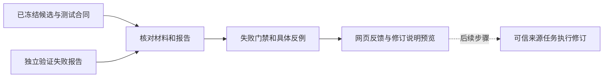

# 第10M步：从“验证失败”到可理解的修订反馈

## 1. 为什么还需要这一步

第10L已经能在网页排队验证候选，并看到通过/失败以及总分。但是只告诉人或Agent“失败了”，仍不足以指导修改：到底是代码不能运行、结果不满足案例，还是与基线相比没有达到门槛？如果只依靠模型猜测原因，下一次可能改错地方。

本步把已经保存的独立报告整理成结构化反馈。输入、预期、实际输出与报告身份一起显示，并准备一段修订说明。网页按钮是“查看修订反馈”，不会发送消息或调用模型。



本步做完的是实线部分。来源任务持久绑定、修订消息派发、新旧候选谱系和次数预算仍需后续接入，不能把显示一段提示词当作Agent已经修好了工具。

## 2. 原仓库如何处理

参考仓库提交固定为67d275494c50f1e5c205b96b72a7b1623acfbe1d。本步独立实现其职责，没有复制整个协调器。

- `packages/extensions/tool-curation/tool-repair-prompt.ts` 的 `buildToolRepairPrompt`：将失败问题、比较合同、领域案例和基准证据组织成修订任务。
- `apps/api/router.ts` 的 `processAutomationRun`：区分普通验证失败和执行基础设施失败，检查修订次数、报告及来源任务。
- 同文件 `sendAutomatedRepair`：经既有任务消息服务向来源任务发修订消息。任务已结束则拒绝，不偷偷恢复旧任务。
- `packages/capability-platform/tool-automation.ts`：记录根提案、来源任务、替代提案和尝试次数。这里的候选替代关系不同于正式工具版本的parent。

原版把失败反馈生成和自动派发接在一起；本学习步先完成可独立查看、检查的反馈模块。我们现有的数值范围候选已经通过验证，来源网页任务也已结束，因此不改变它来制造一个失败案例。

还有一处有意收紧的差异：原版修订说明要求新提案重新完整提供测试、基线、权限和重复性等字段，并允许根据真实能力选择合同；它并不强制这些字段与失败提案逐字节相同。本学习步则要求保留原测试、基线、权限、重复性和minNetGain，让教学修订只能靠改进实现达到原要求。这是个人版用于控制比较条件的约束，不是原版已经实现的自动合同冻结机制；本轮只是说明中的要求，跨提案的程序强制核对仍未实现。

## 3. 用什么新例子观察失败

新材料在 `examples/08-tool-repair-feedback/proposal.draft.json`，工具名 `summarize_numeric_range_feedback`，明确标注故意错误的教学候选。代码由人提供，没有让模型生成。

错误是：

```js
const min = values[0], max = values[values.length - 1];
```

它把第一个数当最小值、最后一个数当最大值。对于已经排序的 `[-2,0,5]`，结果确实正确；对于 `[6,2,4]`，结果是：

| 字段 | 冻结测试要求 | 实际结果 |
|---|---:|---:|
| count | 3 | 3 |
| min | 2 | 6 |
| max | 6 | 4 |
| range | 4 | -2 |

这张表能指出具体不满足的约定。正确修订应修改寻找极值的算法，再构建新镜像；不能删除乱序案例，也不能把预期改成错误输出。

现有可信builder完成一次排序输入调试、冻结和提交。网页只对这份新候选点击验证一次。调试成功并没有让它跳过独立验证。

## 4. 结合文件看数据怎样流动

### `tool-repair-feedback.mjs`：核验证据，再生成反馈

`packages/capability-platform/tool-repair-feedback.mjs` 是本轮核心模块，入口 `getToolRepairFeedback(id,{root})`。

它通过现有 `getRegisteredToolProposal` 读回冻结材料和最新报告。已有读回逻辑检查路径、摘要、提案编号、报告编号、状态与正式父版本绑定；新模块进一步检查报告的案例顺序/名称、执行记录和分数是否一致，再调用原比较谓词复核各结论。它不再执行候选，也不重新评分新输入。

反馈绑定proposalId、toolName、artifactSha256、validationId、reportSha256。摘要相当于材料指纹，确保页面上的结果属于这一份材料和报告；它不证明算法在所有输入上正确。

业务输入和预期来自冻结提案；实际输出来自报告。返回固定字段，省略原始stdout/stderr、源码和内部服务器路径。每个业务JSON预览最多4096字节，每组最多展示20个案例；超出时显式写明截断/省略，整体响应至多256KiB。

静态/语法门禁阻止了执行时，案例状态为not_run，即“未运行”。已执行但输出不符是失败；超时、协议无效也有单独状态。这里不把“没有执行证据”硬解释成某个输入的算法错误。

通过、批准或没有报告的候选没有失败修订反馈；材料/报告损坏返回安全错误。正常完整的负报告才可形成普通修订证据。

### `tool-maintenance-worker.mjs`：让反馈与当前作业一致

新增feedback读取方法。如果该候选最新作业仍pending/running，不提供旧反馈，以免用户把上一次失败误认作当前检查结果。原队列领取、执行与状态落盘逻辑保持。

### `apps/api/router.mjs`：只读接口

新增 `GET /v1/tool-proposals/:id/repair-feedback`，返回 `{feedback: ...}` 或null。网页只选择提案编号，不能上传成绩、源码或伪造的报告。沿用已有Host/Origin检查及安全错误响应。

这里“只读”指不改业务记录、材料/报告，不产生新作业或执行。SQLite的readOnly连接仍可能创建正常的WAL/SHM协调旁文件；我们不为了避免旁文件而忽略活动WAL中已提交的真实记录。

### `public/tools.mjs`：把反例讲给人看

新增“查看修订反馈”，与原“查看验证摘要”分别显示。反馈展示门禁、案例输入/预期/实际结果和比较成绩；修订说明可展开，明确写着仅预览、未派发。

网页请求带选择与刷新代次保护：切换到另一个候选、开始新验证后，迟到的旧响应不能覆盖新选择。所有动态内容通过textContent呈现，业务JSON只作为文本。

同时修复上轮复审指出的小问题：读取失败后成功刷新会清除旧读取错误提示；尚未确认的验证POST警告则保留，避免误以为提交已成功。

本轮审查还发现，原实现每次轮询都重建页面，导致正在阅读的修订说明自动收起。现在按候选编号、报告编号和报告摘要保留展开状态与提示文本框的滚动位置；刷新等待期间仍清空旧证据，只有同一份报告重新读回才恢复阅读状态。换候选、换报告、开始验证或进入排队/运行状态都会清除该偏好。真实浏览器已验证刷新保持展开、切换重置。门禁和运行状态显示中文；“领域案例：展示3/3”表示展示了全部三个案例，并不是三个都通过。

## 5. 修订说明有什么用

说明把失败报告身份、实际比较规则和修订约束放在一起。对象按递归字段子集比较，数组要求长度与顺序一致，标量按精确值比较；exact重复性还比较两次stdout/stderr/filesDigest。基准净增益是候选通过数量减去基线通过数量。

它要求保留旧材料和报告、同名提交新候选、保持原测试/基线/权限/重复性和净收益门槛。源码改变必须重新构建、冻结镜像，再实际提交。文字上声称已修好不能替代新提案编号，更不等于通过或批准。

业务JSON即使包含指令文字也只是证据数据，不应当成为执行命令。省略的预览不代表完整材料；未来自动派发还必须提供完整且可信的任务上下文，不能直接把网页截断预览当完整修复输入。

## 6. 已观察到的真实结果

新提案cf7cc77a-b835-4c0c-8946-1b1f25d3749b，报告72889c5d-c636-4027-ace6-1f7c85c143e4。独立验证结果为verification_failed：

- 材料、镜像与源码、静态、语法、重复性通过。
- 领域案例2/3通过；乱序案例得到min6/max4/range-2。
- 两个比较案例中候选1/2、基线1/2，净增益0，小于门槛1。
- 作业succeeded表示正常完成批改；报告passed=false表示工具未达到要求，两者不矛盾。

9次业务运行是2次重复性+3个领域案例+候选/基线各2个比较案例；另有2次语法检查。此前构建调试使用排序输入，只有1次业务执行。本轮没有模型请求、修订消息或正式发布。

构建创建2个临时容器，验证创建11个，共13个均已清理。网页后台在空闲时完成项目内重启；重启前后作业、请求记录、运行证据和6016字节的反馈完全一致，没有新增模型请求或重复验证。旧25份材料、25份构建文件、12份正式调用审计、12份会话记录、任务表与4个运行容器保持；凭据仅检查元数据，内容未打印、复制或提交。

测试按实际执行阶段记录，不能把局部回归写成最终全套通过：

| 检查阶段 | 实际结果 | 含义 |
| --- | --- | --- |
| Linux完整套件，阅读状态修复前 | 1111项：1109通过、2项平台跳过、0失败 | 后端反馈与整套既有功能通过 |
| Windows两次串行完整检查 | 各1111项：1097通过、1失败、13跳过 | 第一次旧web测试临时端口报bad port；第二次旧workspace测试重命名报EPERM；原日志均保留 |
| Windows失败文件单独复查 | web 7/7；workspace 14通过、3跳过 | 当次复查通过，不能据此抹去完整检查的失败或认定根因 |
| 展开状态与中文标签修复后的相关回归 | Windows与Linux均64/64，无跳过 | 20项反馈/HTTP、23项网页、21项维护队列；覆盖同报告刷新、变更重置与迟到响应 |

Windows旧夹具问题根因尚未确认，未修改旧实现或屏蔽测试；完整输出中的既有Node实验性API警告也保留。最后“展示数量”文案明确化由23项网页测试覆盖，不再次盲目重跑完整套件。

旧已通过的summarize_numeric_range与正式summarize_target_sequence@1.0.1保持原状态；失败工具留作可解释的教学证据，不加入正式目录。

服务器只读复核入口是 `node scripts/verify-web-tool-feedback.mjs`。它检查本轮固定教学候选、真实输出、报告摘要、HTTP读回和容器清理，不运行源码或模型；依赖项目私有的 `runtime/feedback-state.mjs`、`runtime/feedback-state-before.json`、`runtime/feedback-build.json`。它不是在全新clone里直接运行的通用测试：未来新增候选/报告后，固定总数断言可能不再适用，不能改写历史来迎合旧断言。

私有证据入口：`runtime/feedback-tests-01.json`（Linux完整测试）、`runtime/feedback-fix-tests-01.json`（修复后64项）、`runtime/feedback-acceptance-01.json`与`-02.json`（重启前后逐项一致）、`runtime/feedback-task-review.md`（发现问题和限定复审）。原Windows失败日志见 `runtime/feedback-task-1-windows-serial-full.log`、`-final.log`；最终网页截图为本机 `runtime/feedback-browser.png`。这些生成物和真实运行记录留在runtime，不进入Git。

## 7. 下一步

继续按原版把可信来源任务、固定修订请求编号、预算与替代谱系接起来，再用新的可继续任务完成“失败→收到反馈→重新构建→新提案”的真实过程。已结束旧任务不恢复；本轮教学候选由可信CLI提交，没有可自动回发的来源网页任务。

这些案例和基线都是教学材料，不是隐藏测试或科学效果评价。本步证明反馈链路可检查，不能证明Agent自主修订或自进化有效。
