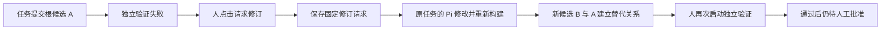

# 第10N步：把失败反馈交回来源任务，接收新的工具候选

本步承接第10M的反馈预览，实现可信来源绑定、显式派发一轮修订，以及新旧候选的替代关系。真实验收、测试与同步结果在本文后半部记录；不能用设计目标代替运行结果。

## 1. 从哪里继续

此前系统已经能让网页里的 Pi 构建工具、提交候选，再由独立验证器运行冻结案例。失败时页面能解释哪个输入、预期和实际输出不一致。但系统还不能可靠回答两个问题：应该把反馈发给哪个任务？后来出现的候选究竟是在修订谁？

本步的流程是：



“请求修订”会真实运行模型；“查看修订反馈”和刷新页面仍是读取已有证据。一次点击只发一轮任务消息，不自动验证下一份候选，也不自动批准上线。

## 2. 原仓库对应哪一部分

参考提交固定为 `67d275494c50f1e5c205b96b72a7b1623acfbe1d`。

| 原仓库文件 | 作用 | 本步对应 |
| --- | --- | --- |
| `packages/extensions/tool-curation/tool-repair-prompt.ts` | 将失败报告组织为修订提示 | 完整原提案、冻结合同和完整报告进入修订消息 |
| `apps/api/router.ts` 的 `sendAutomatedRepair` | 通过已有消息服务发回来源任务 | `tool-repair-service.mjs` 复用同一个 `TaskMessageService` |
| `packages/capability-platform/tool-automation.ts` | 来源、根提案、尝试次数、替代状态 | 登记事件中的来源/替代关系，加独立修订请求库 |
| `packages/task-core/task-message-service.ts` | 同一任务消息与请求去重 | 继续使用个人版已有任务消息服务 |

原版默认自动协调验证、修复和批准；我们在学习阶段保留显式修订、显式验证和人工批准。原版可凭来源任务加同名候选识别替代，且来源支持请求头或唯一活跃任务推断；个人版使用已核验执行租约，并绑定具体修订请求。这些是有意收紧，不冒称逐行复制原版。

原版提示要求重新提交完整测试等字段，允许重写合同。本步则由程序强制保留原测试、期望、基线、权限等条件，便于观察代码是否在同一要求下变好。这同样是个人学习版的额外约束。

## 3. 来源身份为什么要单独保存

聊天列表中的任务编号，只能告诉我们一个任务存在。模型在参数里写“我来自任务 X”，不能证明当前调用确实属于 X。

现有 `tool-call-leases.mjs` 已由宿主核验每轮的任务、执行会话、容器、轮次和实际运行编号。本步沿用这五项 `taskContext`：

`taskId → executionSessionId → sandboxId → agentTurnId → agentRunId`

`task-tool-builders.mjs` 把可信身份传给构建服务；`tool-build-sessions.mjs` 在真实提交时传给生命周期；`tool-lifecycle.mjs` 再交给 `tool-registry.mjs`。登记提案和保存 `proposal_submitted` 事件在同一个事务中完成，事件包含来源身份，避免只留下候选却丢失来源。

`tool-proposal-source.mjs` 读回时核对材料身份、唯一提交事件和来源格式。已有 registry 仍为 schema4，新增信息放在既有事件 details 内；旧事件不回填。旧 CLI 候选没有可信网页来源时，只能继续查看反馈，不能任意选个任务代修。已结束的旧任务也不会自动恢复。

## 4. 修订请求为什么需要另一本记录

工具登记库回答“有哪些候选和版本”；修订请求库回答“哪一次失败被交给了哪个任务，现在进行到哪一步”。这是两个不同问题。

`tool-repair-store.mjs` 在 `runtime/tool-repair/repairs.sqlite` 保存独立 schema1 数据。一个旧候选对应一个固定请求：`auto-tool-repair:<proposalId>`。请求绑定旧候选、材料摘要、报告编号与摘要、来源、根提案和尝试次数，并在调用模型之前保存完整消息。

浏览器只发送 `{validationId, reportSha256}`，不能指定来源任务、提示词或成绩。同候选同报告重试读回原票据；绑定另一报告则冲突。底层任务消息服务还有第二层相同请求编号去重。网页回执丢失或进程重启时，不能因为没看到结果就再付费发一轮。

状态含义：

| 状态 | 直白含义 |
| --- | --- |
| `dispatching` | 已记下请求，正在交给任务消息服务 |
| `running` | 修订轮已经接纳，等待运行收尾 |
| `awaiting_replacement` | 对话正常结束，但没有收到真实新候选 |
| `superseded` | 已存在与本请求绑定的新候选；不表示新候选已验证 |
| `failed` | 本轮运行或保存结果失败 |
| `interrupted` | 服务中断，无法确认完整执行；不自动重发 |

数据库持久化使状态可以跨进程读回，但不让网络、模型和文件系统变成一个全局原子事务。因此中断保留不确定性，不虚构恰好执行成功。已提交的新候选事件可以作为独立证据证明发生了替代。

## 5. 派发服务到底检查什么

`tool-repair-service.mjs` 负责协调，不另造一个 Agent。它先核验失败报告、来源任务是否仍可继续、是否忙碌、有无在途验证、维护队列是否暂停，以及链上尝试次数。

检查通过后，完整候选源码、合同和失败报告组成修订消息。第10M网页只显示有界预览；这里不能把截断预览冒充全部上下文。消息上限同时受 120000 字符和 256KiB 限制，超出就在发模型前拒绝。

随后调用已有 `TaskMessageService.start`，由原来的 Pi、Agent Compose 和构建工具完成工作。`apps/api/bootstrap.mjs` 把同一个消息服务交给聊天路由和修订服务，避免两个入口各自维护一份“任务是否运行中”的判断。

`apps/api/router.mjs` 提供修订状态 GET 和修订 POST。`tool-maintenance-worker.mjs` 与修订服务互相检查同候选是否正在处理，避免网页一边验证旧候选、一边发起修订。这个互斥限于当前网页进程；受信 CLI 维护仍需避免并发，不能误解成所有进程共享的全局锁。

关闭网页后台时，先停止接纳修订，再等待已经接纳的消息和资源收尾。只有成功监听端口的服务实例才恢复旧修订状态，端口冲突的另一个进程不能擅自改状态。

## 6. 怎样确认新候选确实是这一次修订

构建服务在新提案登记前调用宿主的 `registrationPolicy`。它检查当前任务与运行编号、正在处理的用户消息请求编号，以及持久修订票据是否匹配。只同名、只同任务、只在模型文字里声明“替代 A”都不够。

`tool-repair-contract.mjs` 负责冻结条件的比较：工具名、运行时、依赖、权限、重复性、冒烟输入、领域案例、基线、比较案例、净收益门槛与正式 parent 保持一致；对象键顺序无关，数组顺序保留。源码可以改，必须使用新构建会话和真实新镜像。原构建会话的重复提交仍返回原收据，不能因此登记两份候选。

新的 `proposal_submitted` 事件记下 `requestId`、`rootProposalId`、`previousProposalId` 和 `attempt`。一个修订请求最多接纳一个替代候选，注册表事务内再次检查，避免两个并发提交同时通过外层检查。

根候选次数为0，新候选为1，后续最多到3。这里的“三次”指同一绑定修订链的替代深度，不是三次底层模型响应、三次工具操作或费用额度。普通新任务仍可提出新能力，所以它也不是整个账号的全局预算。

正式 `parent` 是已发布工具版本之间的关系；本步 `previousProposalId` 是尚未发布候选的修订关系，两者不能混为一谈。新候选登记后仍为 `submitted`。

## 7. 网页如何使用

`public/tools.mjs` 在候选反馈区域显示可信来源、修订次数和状态。只有当前报告与可修订状态一致，才允许显式请求。点击后禁用重复提交；回执不明时先刷新检查，不自动重放。切换候选、换报告或迟到响应都不能把旧状态填回当前选择。

页面会说明修订消耗模型额度，并显示收到的新候选编号。之后要单独点击新候选的验证入口。原有修订说明展开和滚动状态保留逻辑仍适用。

审查还补齐了“验证回执丢失”的边界：此前验证请求的 UUID 可能仍保存在浏览器里，这时不能因为重新读到一个旧失败报告，就允许发另一条修订请求。现在同候选未确认的验证会阻止修订，重载页面也保留约束；仍需沿用原 UUID 显式确认验证结果。其他候选不受这一候选的不确定状态影响。反方向也一样，修订在途或回执未知时不能发起冲突验证。页面的可修订提示仅表示本地记录允许，真正提交时后台还会检查实时运行环境。

## 8. 实际验收与证据

本轮已通过网页实际派发一轮，但没有得到成功登记的替代候选。代码流程与边界测试通过，不等于这次模型把整个修订任务做完。

新建任务 `245a0189-ed75-4d88-8305-cc4a0a44eb03`，执行会话 `c35692f2-01f1-4845-a481-fb084b9f61ec`。只发送一次根候选构建消息和一次修订消息，没有追加付费重试。

1. 第一轮按人为提供的故障草稿构建候选 `b1bf4288-e3dd-4552-906d-f1ba1e4991f0`，真实来源保存在提交事件中。构建会话 `cea3258f-a2fe-4661-8045-33d175ad6322`。
2. 网页单独启动验证，作业 `6eb99dfb-efa4-4a97-a04c-1f8989891982` 正常完成，报告 `872f96e1-6dcc-4f4e-a036-6b2577be4a6c` 不通过。领域案例2/3，候选和基线都1/2，净增0。报告 SHA-256 为 `aab1f6d1c562f828338c63f29314ea507c06d46b1c0ec62f4d608670d9f17c10`。
3. 在网页点击“请求一轮修订”，同任务收到持久记录的完整提示。Pi 创建新构建会话 `006e1d55-f5d4-45d2-b956-25dbc28134d7`，将取首尾值改为扫描全部元素：

   ```js
   let min = values[0];
   let max = values[0];
   for (let i = 1; i < values.length; i++) {
     const v = values[i];
     if (v < min) min = v;
     if (v > max) max = v;
   }
   ```

4. 一次调试命令运行三个输入，输出与原预期一致；其中 `[6,2,4]` 得到 `count:3, min:2, max:6, range:4`。修订镜像 `sha256:fdde4b1505f52eb815b6f716343ef548fb382f620a698bebddbeed8088d6a2fc` 已冻结。这是构建阶段调试，尚不是独立验证通过。
5. 提交时模型却额外写入 `parent: {toolName: "summarize_numeric_range_repair", version: "1.0.0"}`。原候选没有 parent，派发提示明确要求保持它；这里也没有该工具的正式1.0.0。参数的基本格式合法，但不满足修订合同，不能把格式合法等同于业务允许。
6. 提交失败，登记库没有第二份候选，修订状态为 `awaiting_replacement`，网页明确显示“本轮已结束，未收到新候选”。原失败候选和报告保留，没有新增独立验证、批准或激活。教学任务随后结束，运行环境释放。

这也暴露一个真实可改进处：构建入口将多种拒绝统一成“操作可能已完成，请检查宿主记录”。Pi 把它解释为“后台宕机”，又尝试对已经 finalized 的会话运行命令、发送空参数，得到类似错误后加固了自己的误判。相同提示不能证明相同原因。实际轨迹含两次 describe 对象参数错误，以及修订阶段四次工具错误；模型在输出文件中还误称 parent 允许改变、原候选仍为 submitted。原输出不修写，本说明据主机材料纠正。今后应把可安全公开的合同拒绝与结果未知分开，保持未知操作不盲目重放。

验收脚本 `scripts/verify-controlled-tool-repair.mjs` 核对的是本次实际结果：来源、完整消息、被拒绝的实际参数、没有替代登记、镜像、容器收尾和旧状态。它不重新运行模型或工具。`ok: true` 若出现，只表示这些证据互相一致，不能读成“模型修订成功”；成功替代及再次独立验证的真实演示仍待补齐。

本轮只读核验已通过。核验器用保存的消息和调用参数，在内存中重建提交时的登记检查视图：实际参数得到 `registration_refused`；仅在内存副本中移除多出的 parent 后，能得到预期替代关系。这是定位合同冲突的诊断，没有重新提交、登记或执行副本。实际宿主公开事件只记录提交失败，没有保存细化原因，所以不能把这段事后诊断冒充当时返回给 Pi 的错误说明。

构建共2次成功调试命令，分别执行1个和3个样例；4个构建/打包容器与11个独立验证容器全部移除，新任务guest也已释放。两个成品镜像作为本轮证据保留。旧29份材料、28份构建文件、12份正式调用审计、12份会话文件及原任务记录保持，原4个运行容器和正式目录保持。注册表为schema4，共6候选/5验证/2版本/15事件。结束后仅重启本项目后台，再次读取的验收报告与重启前完全一致，没有重发模型消息。

两轮任务内部实际发生25次模型响应、28次Pi工具调用，其中6次工具错误。原生usage合计242151 tokens：input 22851、output 5953、cacheRead 213347、cacheWrite 0。缓存读数已计入total，不能再次相加；SDK显示的价格字段不能替代实际账单，费用仍未知。“一轮任务”并不等于“一次模型响应”。

当前服务器内只读复核命令为 `node scripts/verify-controlled-tool-repair.mjs`，依赖私有 `runtime/repair-state.mjs`、原始快照与运行日志，固定本次结束状态；不是空白克隆后即可运行的通用测试。主要回执为 `runtime/repair-acceptance-01.json`、`repair-acceptance-02.json`，另有 `repair-ended-history.json`、`repair-notes.json`、两端测试日志及审查报告。第10M只认旧总数的固定验收不再适用于当前新状态，原证据不改写。

最终两端完整代码回归共1170项：Windows 1157通过/13平台跳过，Linux 1168通过/2平台跳过，均0失败。新增后端34项行为用例；网页修订及原有行为共38项。审查发现的“验证回执未知时仍可修订”已通过先失败、后通过的用例修复，并通过限定复审。真实演示开始前恢复了本机3000端口的SSH隧道；没有更改公网监听或系统配置。

## 9. 学到了什么，以及仍未完成什么

Agent 能写一份代码，只是起点。完整应用还需要知道是谁提出的、按什么要求验证、根据哪份错误修订、是否真正交出新产物，以及是否可以发布。本步补齐的是其中的单次修订闭环。

它还不是从任务轨迹主动发现缺失能力的 Curator，也不是自动循环改进、自动批准或可靠自进化的效果证明。教学例子由人指定，基线故意简单。本轮只证明真实来源、派发和未成功交付时的状态区分；不能把调试通过当成替代候选已验证。

下一步先完善合同拒绝的明确反馈，再用单独记录、明确预算的新演示补齐“合法替代登记→独立验证”。旧任务已经结束，旧失败轨迹保留，不补写成成功；完成这个缺口后，再进入原仓库的 Curator 能力发现流程。
